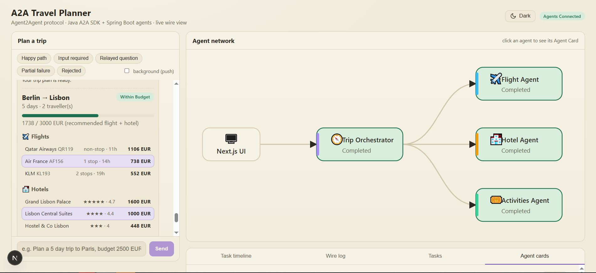
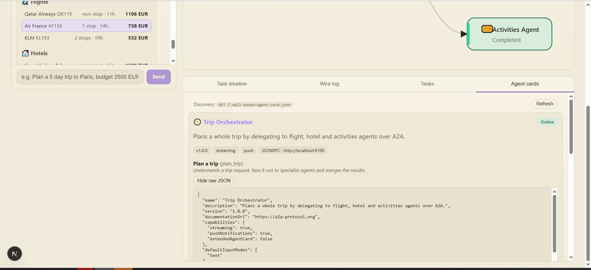
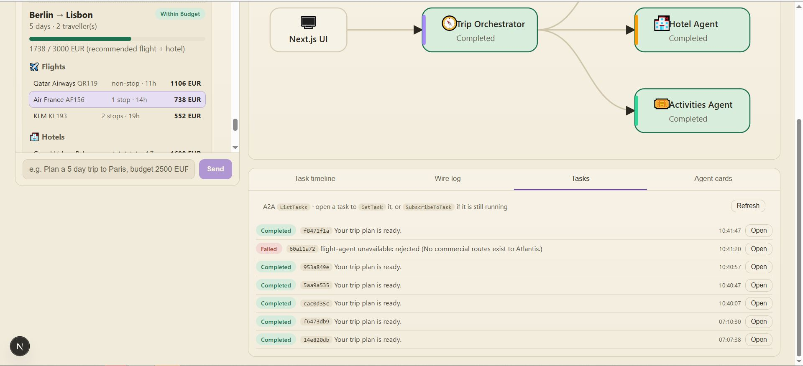
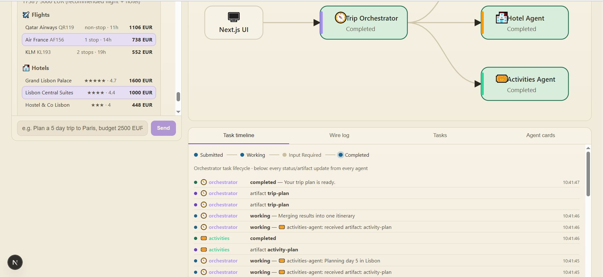
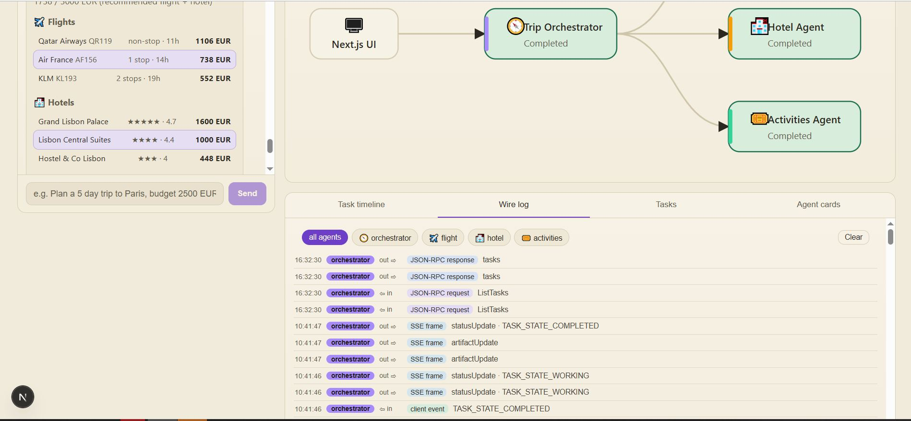

# A2A Travel Planner: Agent2Agent protocol demo

Java A2A SDK (`org.a2aproject.sdk:1.3.0.Final`) + Spring Boot 4.1 agents, visualised by a Next.js 16.4 app.

```
Next.js UI ──A2A SendStreamingMessage──▶ Orchestrator :9100 ──A2A──▶ Flight     :9101
 (proxy routes)                              (server + client)  ├──▶ Hotel      :9102
                                                                └──▶ Activities :9103
```

## Run (Windows PowerShell, JDK 21 + Maven + Node 20+)
Backend: Spring Boot **4.1.1** (Spring Framework 7, Jakarta EE 11, Jackson 3). Frontend: Next.js **16.4** (Turbopack, `cacheComponents`, sources in `frontend/src`).
```powershell
# 1. backend: four terminals (or run the *Application classes from IntelliJ)
cd backend
mvn -q install -DskipTests
mvn -pl flight-agent spring-boot:run
mvn -pl hotel-agent spring-boot:run
mvn -pl activities-agent spring-boot:run
mvn -pl orchestrator-agent spring-boot:run

# 2. frontend
cd ..\frontend
npm install
npm run dev        # http://localhost:3000
```
Agent URLs can be changed via `frontend/.env.local` (see `.env.example`).

## What the demo shows
| A2A feature | Where |
| --- | --- |
| Agent Card discovery | "Agent cards" tab, `GET /.well-known/agent-card.json` |
| JSON-RPC `SendStreamingMessage` + SSE | UI → orchestrator; orchestrator → each agent |
| Task lifecycle (submitted, working, completed) | "Task timeline" tab |
| `input-required` multi-turn | scenario "Input required" (answer with a budget) |
| `failed` / `rejected` states | scenarios "Partial failure" and "Rejected" |
| Artifacts with text + structured `DataPart` | trip plan card |
| `CancelTask` | "Cancel task" button while running |
| Agent-to-agent delegation, in parallel | flowing dots in the network graph |
| Relayed `input-required` (hotel asks, you answer) | scenario "Relayed question" |
| `CancelTask` propagated to sub-agents | Cancel button; sub-tasks end `canceled` too |
| `ListTasks` / `GetTask` / `SubscribeToTask` | "Tasks" tab; refresh mid-run and the task re-attaches |
| Push notifications (webhook) | "background (push)" toggle |
| Streamed artifacts (`append`, `lastChunk`) | activities plan per day, trip plan in two chunks |
| Dark / light theme (soft charcoal and cream) | theme button in the top bar |
| Raw wire traffic | "Wire log" tab (every agent exposes `/trace/stream`) |

## Release notes
See [RELEASE_NOTES.md](RELEASE_NOTES.md) (current version: **1.0.0**).

## Tests
```powershell
cd backend;  mvn verify          # TripRequestTest + end-to-end suite (boots all four agents)
cd frontend; npm test            # 47 tests: parsers, state derivation, push hub, every API route, themes
```
CI runs both (`.github/workflows/ci.yml`). See [docs/06-testing.md](docs/06-testing.md) for what is verified.

## Documentation
**New to A2A?** Start with A2A explained(concepts, benefits, applicability, do's and don'ts).

1. [Architecture overview](docs/01-architecture-overview.md)
2. [A2A protocol flows](docs/02-a2a-protocol-flows.md)
3. [Backend design](docs/03-backend-design.md)
4. [Frontend design](docs/04-frontend-design.md)
5. [Wire formats, limitations, extensions](docs/05-wire-formats-and-extensions.md)
6. [Testing](docs/06-testing.md)
7. [A2A explained](docs/07-a2a-explained.md)

## Notes
- The SDK's server side is CDI-based (reference server = Quarkus). `a2a-spring-support` wires the same
  `DefaultRequestHandler` / `JSONRPCHandler` as Spring beans and exposes them via `A2AController`.
- Push notifications are enabled on the orchestrator only (`a2a.push.enabled=true`).
- No LLM or API key is needed; agents use deterministic simulated logic.

## Few screenshots:









