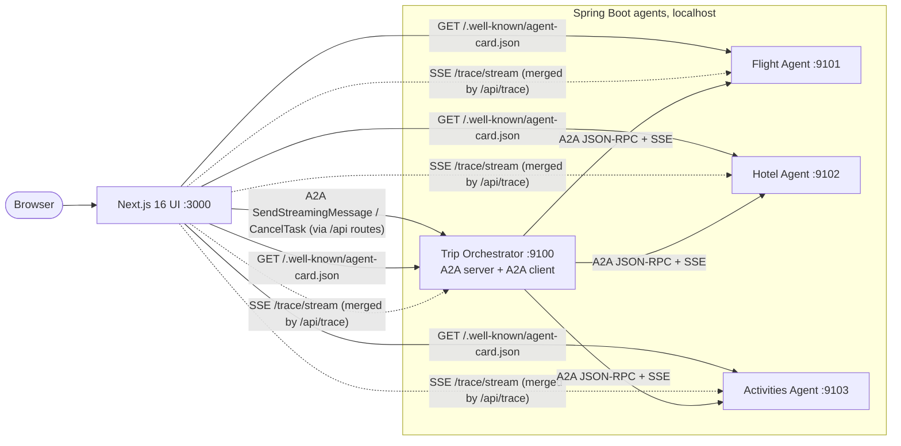

# 01 · Architecture overview

A demo of the **Agent2Agent (A2A) protocol**: a Next.js UI talks to an orchestrator agent, which delegates to three
specialist agents, all built with the **Java A2A SDK 1.3.0.Final** on **Spring Boot 4.1.1** (Spring Framework 7, Jakarta EE 11).

## Goals
- Show A2A features end to end: discovery, streaming, task lifecycle, artifacts, multi-turn, failure, cancellation.
- Make the protocol *visible*: every JSON-RPC message and SSE frame is observable in the UI.
- Run locally with no LLM, no API keys, and no containers.

## System context

## Components

| Component | Port | Role | Key technology |
|---|---|---|---|
| Next.js UI | 3000 | Chat, agent graph, task timeline, wire log, Agent Cards | Next.js 16.4 (`cacheComponents`), React 19, plain CSS/SVG |
| Trip Orchestrator | 9100 | Understands the request, asks for missing info, fans out, merges results | Spring Boot + SDK server **and** SDK client |
| Flight Agent | 9101 | Produces flight options; rejects impossible destinations | Spring Boot + SDK server |
| Hotel Agent | 9102 | Produces hotel options sized to the budget | Spring Boot + SDK server |
| Activities Agent | 9103 | Day-by-day plan; can simulate a failure | Spring Boot + SDK server |
| `a2a-spring-support` | n/a | Shared library: SDK wiring, HTTP endpoints, tracing, helpers | Spring MVC, A2A SDK |

## Network and endpoints

Every agent exposes the same three endpoints (from `A2AController`):

| Method & path | Purpose |
|---|---|
| `GET /.well-known/agent-card.json` | Agent Card (discovery) |
| `POST /` | A2A JSON-RPC 2.0. Blocking methods return JSON; streaming methods return `text/event-stream` |
| `GET /trace/stream` | Demo-only SSE "network tap" of everything that agent sent or received |

The browser never talks to the agents directly. Next.js route handlers run server-side and proxy:

| UI route | Does |
|---|---|
| `POST /api/chat` | Wraps text in `SendStreamingMessage`, pipes the SSE stream back |
| `POST /api/cancel` | Sends `CancelTask` |
| `GET /api/cards` | Fetches all four Agent Cards |
| `GET /api/trace` | Merges the four `/trace/stream` feeds into one SSE stream |
| `GET /api/tasks`, `GET /api/tasks/{id}` | `ListTasks`, `GetTask` |
| `POST /api/subscribe` | `SubscribeToTask` (SSE pass-through) |
| `POST /api/push/webhook`, `GET /api/push/stream` | Receive push notifications and relay them to the browser |

## Technology choices

- **A2A transport:** JSON-RPC over HTTP with SSE streaming (one of the three transports the SDK supports).
- **State:** in-memory task store and queue manager (SDK defaults). Restarting an agent clears its tasks.
- **Push notifications:** enabled on the orchestrator only (`a2a.push.enabled=true`); the UI receives webhooks in background mode.
- **Spring Boot 4 specifics:** the web starter is `spring-boot-starter-webmvc` (the old `spring-boot-starter-web` is deprecated); JSON is Jackson 3 (`tools.jackson`); the A2A SDK itself uses Gson, so the two never meet.
- **Why a Spring support module:** the SDK server is CDI-based and its reference server is Quarkus. The module builds
  the same SDK objects as Spring beans (see [03-backend-design.md](03-backend-design.md)).

## Document map
1. Architecture overview (this file)
2. [A2A protocol flows](02-a2a-protocol-flows.md): sequence diagrams and the task state machine
3. [Backend design](03-backend-design.md): modules, SDK wiring, orchestrator logic
4. [Frontend design](04-frontend-design.md): routes, data flow, panels
5. [Wire formats, limitations and extensions](05-wire-formats-and-extensions.md)
6. [Testing](06-testing.md): what is covered, how to run it, what is verified
