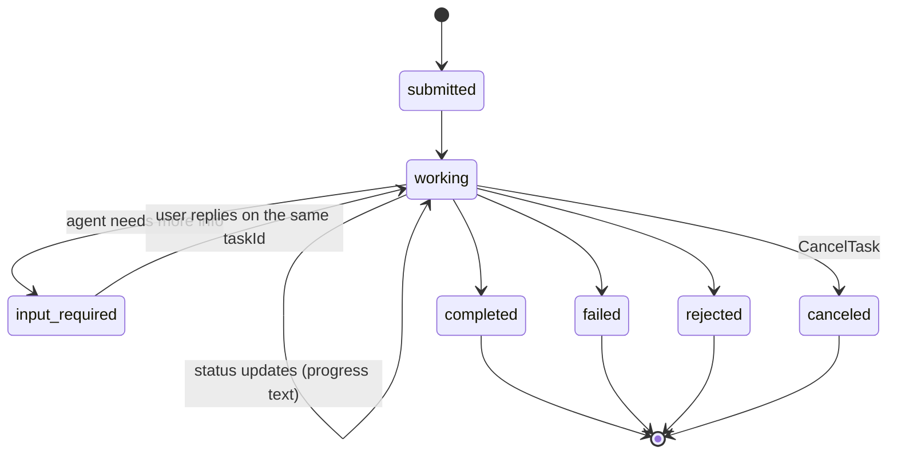
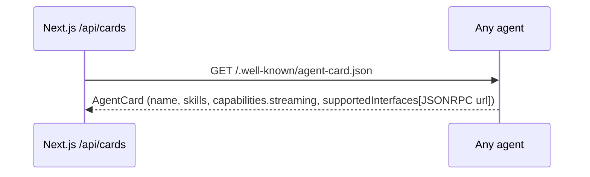
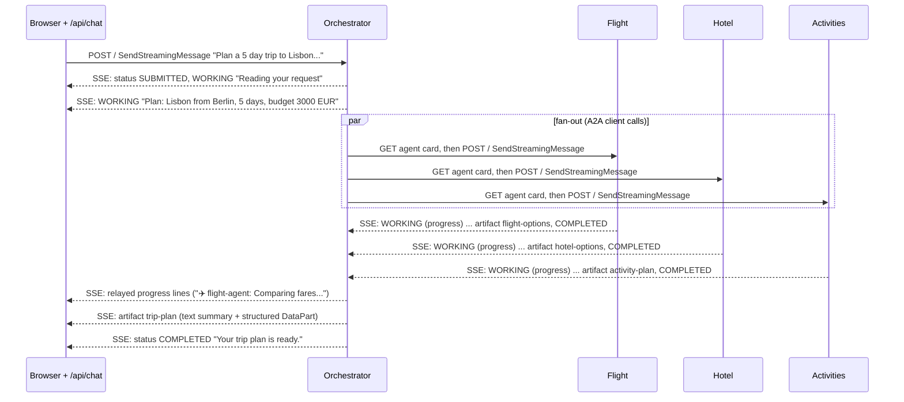
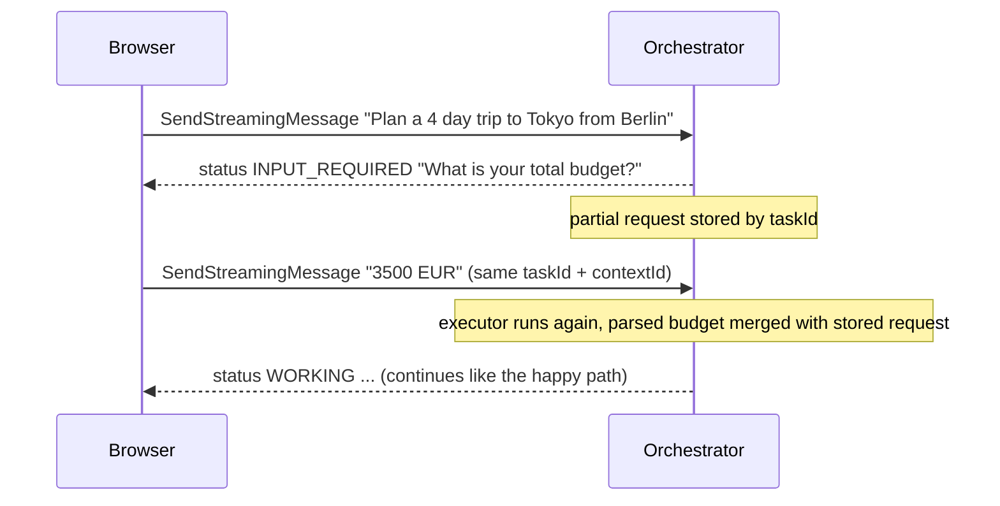
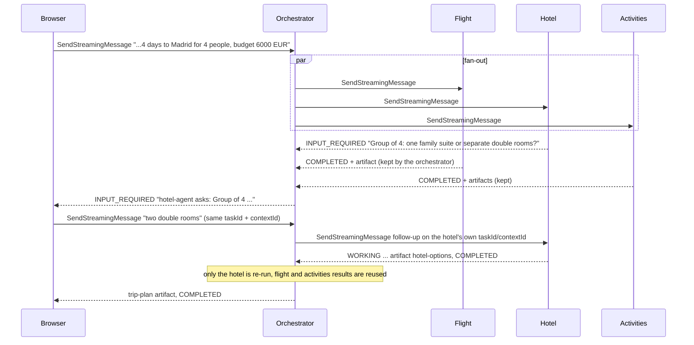
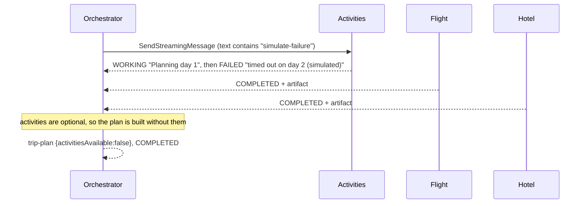
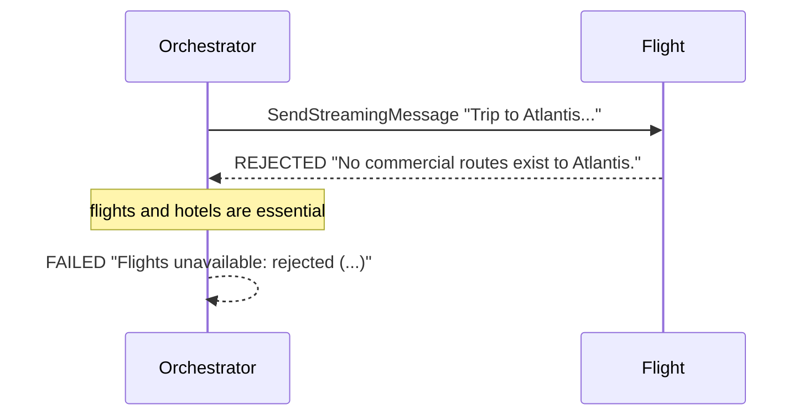
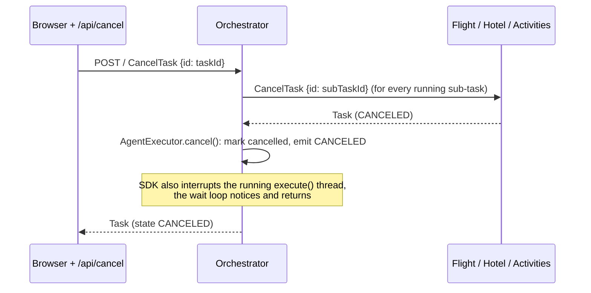
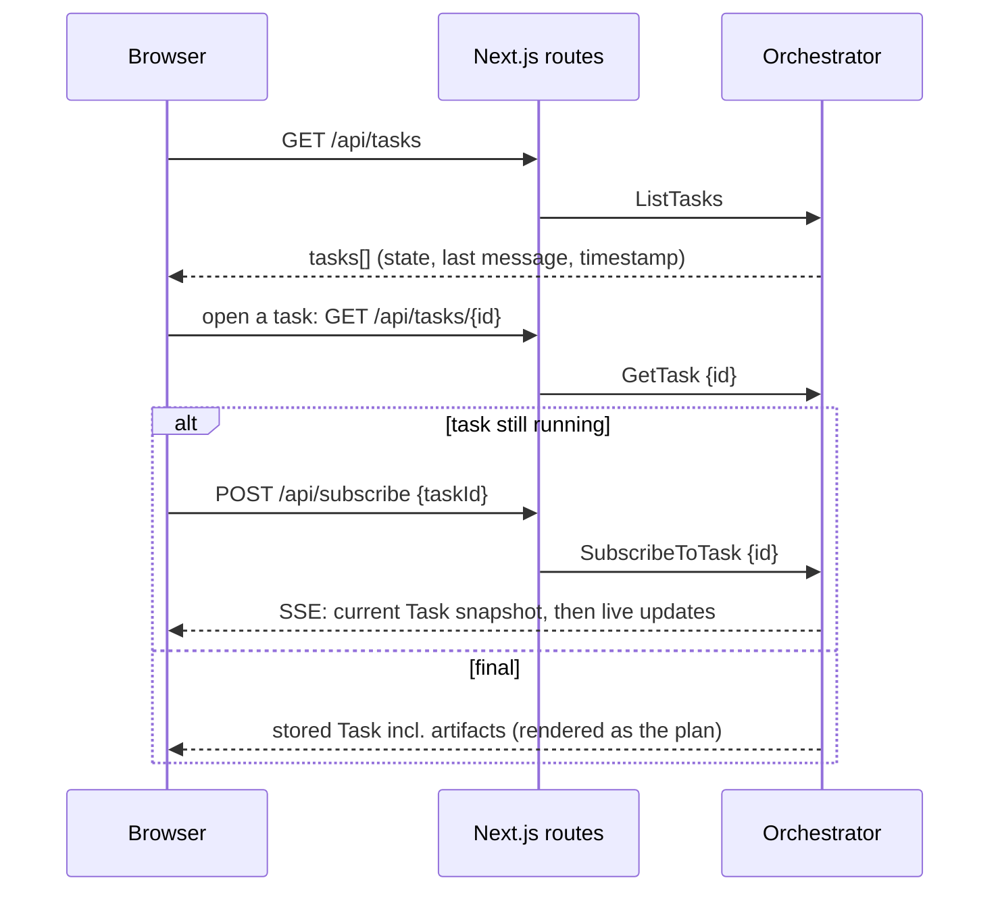
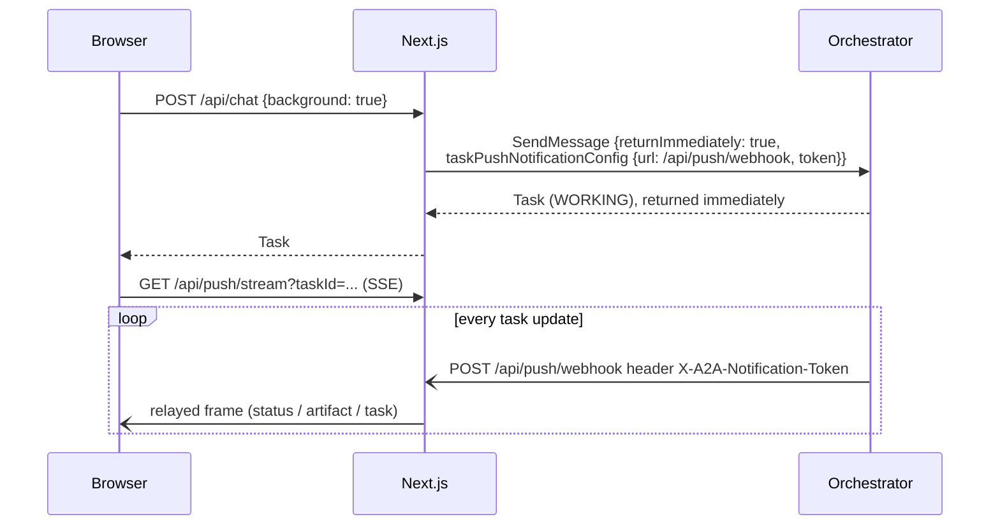

# 02 · A2A protocol flows

All flows below are real traffic you can watch in the UI (Wire log and Task timeline tabs).

## Task state machine (as used by the demo)

Wire names are `TASK_STATE_SUBMITTED`, `TASK_STATE_WORKING`, `TASK_STATE_INPUT_REQUIRED`, and so on.
Terminal states are final; `input-required` is interrupted (the stream ends, but the task can continue).

## 1. Discovery

The orchestrator does the same before each delegation (`A2A.getAgentCard(url)`).

## 2. Happy path: parallel delegation with streaming

Sub-agent progress is relayed as the orchestrator's own WORKING updates. The merged result is a single `trip-plan` artifact.

## 3. Multi-turn: `input-required`

The UI remembers `taskId`/`contextId` from the last frame and attaches them when the task is `input-required`.

## 3b. Multi-turn: a sub-agent's question is relayed (INPUT_REQUIRED propagates up the chain)

The orchestrator keeps a `TripState` per task (parsed trip, one `RemoteCall` per sub-agent, and which agent is waiting).

## 4. Partial failure (optional agent fails)

## 5. Rejection (essential agent refuses)

## 6. Cancellation, propagated to sub-agents

`RemoteCall` remembers each sub-agent's task id as soon as the first event arrives, so `cancel()` can address it.

## 7. Task history and re-attaching (GetTask, ListTasks, SubscribeToTask)

After a page refresh the UI resumes the last running task automatically (its id is kept in `localStorage`).

## 8. Push notifications (background mode)

The webhook rejects calls whose token the UI server did not hand out (HTTP 401).

## 9. Streamed artifacts

An artifact can be delivered in chunks that share one `artifactId`: the first chunk has `append=false`, later chunks
`append=true`, and the final one `lastChunk=true`.
- **Activities agent:** one chunk per day (`TextPart` + `DataPart {day, activities}`).
- **Orchestrator:** the `trip-plan` artifact is a text chunk followed by an appended structured-data chunk.
- The orchestrator accumulates chunks itself (`RemoteCall.artifactParts`) and reassembles the days in order, rather than
  relying on the SDK client's aggregated task.

## Decision table: who decides what

| Situation | Orchestrator reaction |
|---|---|
| Destination or budget missing | Emit `INPUT_REQUIRED`, store partial request |
| Flight or hotel ended in a non-completed final state | Emit `FAILED` with the sub-agent's reason |
| A sub-agent returns `INPUT_REQUIRED` | Emit `INPUT_REQUIRED` with its question; forward the answer to that sub-task |
| `CancelTask` | Cancel every running sub-task, then emit `CANCELED` |
| Activities not `COMPLETED` | Continue, flag `activitiesAvailable: false` |
| No answer within 60 s | Stops waiting; missing results are treated as failures |
