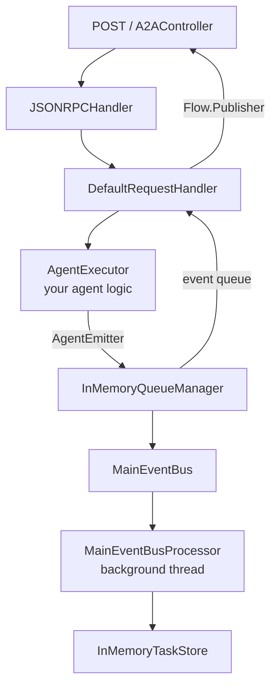
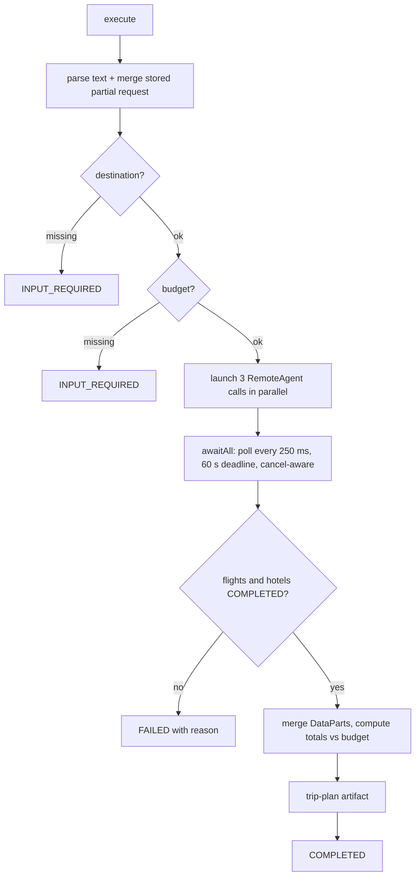

# 03 · Backend design

## Maven layout

```
backend/
├── pom.xml                  parent: Spring Boot 4.1.1, A2A SDK BOM 1.3.0.Final, JDK 21
├── a2a-spring-support/      shared library (auto-configuration)
├── flight-agent/            :9101
├── hotel-agent/             :9102
├── activities-agent/        :9103
└── orchestrator-agent/      :9100
```
Version pins worth knowing: `gson 2.14.0` (overrides the 2.13.2 that Spring Boot 4.1 manages, because the SDK is built against 2.14)
and `protobuf 4.35.1` (the version Spring Boot 4.1.1 manages; the SDK marks protobuf as `provided`, so the support module declares it explicitly).

## `a2a-spring-support`

| Class | Responsibility |
|---|---|
| `A2AAutoConfiguration` | Builds the SDK's server objects as Spring beans (registered through `AutoConfiguration.imports`) |
| `A2AController` | HTTP front door: Agent Card, JSON-RPC (blocking and SSE), trace stream |
| `TraceBus` / `TraceEvent` | In-memory ring buffer (400 events) plus SSE fan-out of everything the agent sees |
| `TripRequest` | Regex parser for destination, origin, days, travellers, budget, currency, `simulate-failure` |
| `AgentSupport` | Helpers: `progress()`, `artifact()`, `agentText()`, interruptible `pause()` |

A host app only provides two beans: an `AgentCard` and an `AgentExecutor`.

### Spring Boot 4 notes
| Topic | What this project does |
|---|---|
| Web starter | `spring-boot-starter-webmvc` (Tomcat 11, Spring MVC 7, Jackson 3); `spring-boot-starter-web` is deprecated in Boot 4 |
| Auto-configuration | Unchanged: `@AutoConfiguration` plus `META-INF/spring/org.springframework.boot.autoconfigure.AutoConfiguration.imports` |
| JSON | Spring serialises `TraceEvent` with Jackson 3. The A2A SDK and the e2e tests use Gson, so nothing depends on Jackson 2 |
| `@PostConstruct` on the SDK's package-private methods | Still honoured by Spring Framework 7 (jakarta.annotation 3.0) |
| Test starters | `spring-boot-starter-test` (JUnit); no MockMvc is used, so no `spring-boot-starter-webmvc-test` is needed |

### How the SDK is wired (it is CDI-based, so Spring builds the pieces by hand)



| Bean | Notes |
|---|---|
| `InMemoryTaskStore`, `MainEventBus`, `InMemoryQueueManager` | Plain constructors, no CDI needed |
| `MainEventBusProcessor` | Its package-private `@PostConstruct`/`@PreDestroy` start and stop the event thread; Spring honours the `jakarta.annotation` annotations |
| `DefaultRequestHandler` | **Not a Spring bean.** Built with its builder inside the `JSONRPCHandler` bean method (see below); `authorizationRequired(false)`, push per `a2a.push.enabled` |
| `JSONRPCHandler` | Public constructor `(AgentCard, RequestHandler, Executor)` |
| Executor | A cached thread pool shared by the handler and event consumers |
| Push notifications | `InMemoryPushNotificationConfigStore` + `BasePushNotificationSender`, switched on per agent with `a2a.push.enabled=true` (orchestrator only). Off = no-op sender and `pushNotificationsEnabled(false)` |

`System.setProperty("org.a2aproject.sdk.transport.skipValidation","true")` skips the SDK's classpath transport check, because the cards are built by hand.

### `A2AController` request handling
1. Parse the body with `JSONRPCUtils.parseRequestBody` and map parse errors to JSON-RPC errors (same catch ladder as the SDK's Quarkus routes).
2. Build a `ServerCallContext` (unauthenticated user, headers, tenant `""`, `A2A-Version`, `A2A-Extensions`).
3. Blocking methods (`SendMessage`, `GetTask`, `CancelTask`, `ListTasks`, push-config methods) are dispatched to `JSONRPCHandler`; the response JSON is produced via the SDK's `SseFormatter` so it matches the wire format exactly.
4. Streaming methods (`SendStreamingMessage`, `SubscribeToTask`) return a `ResponseBodyEmitter`. The controller subscribes to the SDK's `Flow.Publisher` **on the request thread** so no early event is lost, then writes each frame as SSE.
5. Each request, response and frame is also published to the `TraceBus`.

### Why `DefaultRequestHandler` is not a Spring bean
`DefaultRequestHandler` is a CDI class. It has `@Inject` fields (an `A2AConfigProvider` and two CDI `Instance<>` lookups) and an
`@PostConstruct initConfig()` that re-reads its settings from that provider. If Spring manages it:
1. startup fails with *"Field configProvider ... required a bean of type A2AConfigProvider"* (found on the first real run), and
2. registering the SDK's `DefaultValuesConfigProvider` as a workaround makes the error go away but lets `initConfig()` **overwrite
   the builder settings with SDK defaults**: `a2a.authorization.required=true` (with no authorization provider the SDK then
   fails closed and answers every task read/write with `TaskNotFound`) and `a2a.push-notification.enabled=true` on every agent.

So the handler is created as a plain local object inside `a2aJsonRpcHandler(...)`, where Spring never post-processes it and the
builder values stand. The SDK classes that *do* want Spring's lifecycle (`MainEventBusProcessor`'s `@PostConstruct`) stay beans.
Classes with only `@Nullable @Inject` fields (`InMemoryPushNotificationConfigStore`) are safe: Spring 7 treats them as optional.

### Push notifications
With `a2a.push.enabled=true` the request handler stores the `taskPushNotificationConfig` sent in a `SendMessage`
and the sender POSTs every task event to that URL (header `X-A2A-Notification-Token`, body = the streaming event JSON).
The orchestrator's card advertises `pushNotifications: true` from the same property. `PushNotificationUrlValidator.ALLOW_ALL`
is used so localhost webhooks work; a real deployment must validate URLs (SSRF).

## Specialist agents
Each is one class with an `AgentCard` bean and an `AgentExecutor` bean:

```
execute():  submit() if new task
            startWork("Reading the trip request")
            validate input → requiresInput() / reject()
            progress("…"), pause(…)            ← simulated work
            addArtifact(TextPart summary + DataPart structured options)
            complete()
cancel():   cancel()
```
Artifacts carry a human-readable `TextPart` and a machine-readable `DataPart`
(`kind`, `options[]`, `recommendedTotal`, …). The orchestrator reads the `DataPart`.

Agent-specific behaviour:

| Agent | Behaviour worth knowing |
|---|---|
| Flight | Rejects `Mars` / `Atlantis` (`REJECTED`) |
| Hotel | For 3+ travellers and no answer yet, asks "family suite or separate double rooms?" (`INPUT_REQUIRED`); the answer sets `rooms` and price factor |
| Activities | Streams one artifact chunk per day (`append=true`, `lastChunk` on the last); `simulate-failure` makes it `FAILED` on day 2 |

## Orchestrator
`OrchestratorExecutor` (A2A server) uses `RemoteAgent` (A2A client). Each delegated exchange is a `RemoteCall`:
its future, the remote task/context ids, and the artifact chunks received so far. Calls are started on a separate pool,
so the three delegations really run in parallel.



`RemoteAgent.run(prompt, onProgress)`:
1. `A2A.getAgentCard(url)` for discovery.
2. `Client.builder(card)` with the JSON-RPC transport and streaming enabled.
3. `client.sendMessage(...)`; events arrive as `TaskUpdateEvent` / `TaskEvent` / `MessageEvent`.
4. Status text goes to `onProgress`, which the orchestrator relays as its own `WORKING` update (synchronised so its stream stays ordered).
5. The future completes when the sub-task is final or interrupted.

State kept in memory: `states` (a `TripState` per orchestrator task: parsed trip, one `RemoteCall` per sub-agent, and the
sub-agent currently waiting for the user) and `cancelled` (task ids).

Order of checks after the sub-agents finish:
1. Flights or hotels in a failed/rejected/canceled final state → `FAILED` (no point asking the user anything).
2. Any sub-agent in `INPUT_REQUIRED` → relay its question, remember who asked, keep everyone else's results.
3. Otherwise merge and publish the plan; activities failures only set `activitiesAvailable: false`.

`cancel()` sends A2A `CancelTask` to every sub-task before emitting `CANCELED`.

## Tracing model (`TraceEvent`)

| `kind` | Emitted by | Meaning |
|---|---|---|
| `rpc-request` (in) | every agent | Raw JSON-RPC body received |
| `rpc-response` (out) | every agent | Blocking JSON-RPC response sent |
| `sse-frame` (out) | every agent | One SSE frame of a streaming response |
| `delegation` (out) | orchestrator | Agent Card fetch / message sent to a peer |
| `client-event` (in) | orchestrator | Status/artifact event received from a peer |
| `note` | orchestrator | Failures of a delegated call |

Fields: `seq`, `ts`, `agent`, `kind`, `direction`, `method`, `peer`, `payload` (raw JSON or short text).
