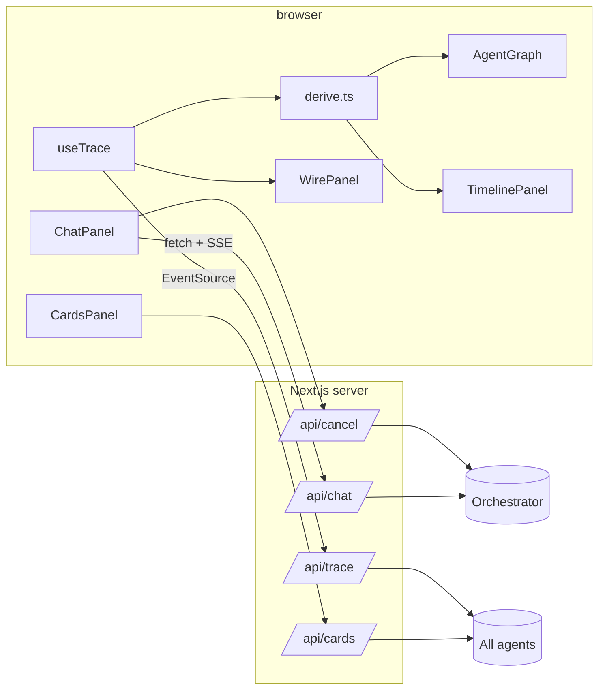

# 04 · Frontend design

Next.js 16.4 (App Router, Turbopack, `cacheComponents` enabled), React 19, TypeScript, plain CSS, and no UI libraries. The graph is hand-written SVG. Sources live under `frontend/src`; the `@/` import alias points at `src/`.

## Structure

```
frontend/
├── next.config.ts            cacheComponents enabled
├── vitest.config.ts, tests/  see 06-testing.md
└── src/
    ├── app/
    │   ├── page.tsx          composition + derived state
    │   ├── layout.tsx, globals.css
    │   └── api/
    │       ├── chat/route.ts        SendStreamingMessage proxy (SSE pass-through, or background mode)
    │       ├── cancel/route.ts      CancelTask proxy
    │       ├── cards/route.ts       fetches all Agent Cards
    │       ├── trace/route.ts       merges the four /trace/stream feeds
    │       ├── tasks/route.ts       ListTasks proxy
    │       ├── tasks/[id]/route.ts  GetTask proxy
    │       ├── subscribe/route.ts   SubscribeToTask proxy (SSE pass-through)
    │       └── push/
    │           ├── webhook/route.ts receives A2A push notifications (token-checked)
    │           └── stream/route.ts  SSE feed of received notifications, per task
    ├── components/
    │   ├── ChatPanel.tsx     chat, scenarios, task continuation, cancel, background mode
    │   ├── TripPlan.tsx      renders the trip-plan artifact
    │   ├── AgentGraph.tsx    SVG network graph
    │   ├── TimelinePanel.tsx lifecycle stepper + status/artifact feed
    │   ├── WirePanel.tsx     raw JSON-RPC / SSE log with filters
    │   ├── TasksPanel.tsx    task history (ListTasks) with Open / Attach
    │   ├── ThemeToggle.tsx   dark / light switch
    │   └── CardsPanel.tsx    Agent Cards (summary + raw JSON)
    └── lib/
        ├── a2a.ts            types, defensive frame parser, SSE reader, task-id extraction
        ├── push-hub.ts       in-memory store/fan-out for received push notifications
        ├── derive.ts         frames, node states, active edges
        ├── useTrace.ts       EventSource hook with de-duplication
        ├── agents.ts         agent metadata (name, colour, env var)
        ├── theme.ts          theme type, resolveTheme(), pre-paint init script
        └── server-config.ts  resolves agent URLs (server-side only)
```

## Data flow



Two independent streams feed the UI:
1. **Conversation stream** (`/api/chat`): the orchestrator's own A2A response; drives the chat bubbles and the trip plan card.
2. **Trace stream** (`/api/trace`): what *every* agent saw; drives the graph, timeline and wire log.

## Key behaviours

**Frame parsing (`lib/a2a.ts`).** `parseFrame` turns a JSON-RPC response into one of
`status | artifact | task | message | error`. It accepts protobuf-JSON names (`statusUpdate`, `TASK_STATE_*`) and
older `kind`-style shapes, and normalises states (`TASK_STATE_INPUT_REQUIRED` becomes `input-required`).

**Multi-turn.** `ChatPanel` stores the last `taskId`/`contextId`/state. If the state is `input-required`, the next
message is sent with those ids, so the orchestrator continues the same task. After a final state, the next message starts a new task.

**Trace de-duplication.** Each agent replays its buffer on reconnect, so `useTrace` keys events by `agent:seq`.
Events are kept in time order and capped at 2000.

**Run scoping.** Sending a new request sets `runStart`, so the graph and timeline only show the current run.
The wire log has its own *Clear* button.

**Graph state.**
- Node colour comes from the latest status frame per agent (working = blue pulse, completed = green, failed/rejected = red, input-required = amber, canceled = grey, offline = dashed).
- Edge animation comes from events in the last 1.4 s: orchestrator traffic lights the UI edge; delegation/client events and sub-agent traffic light the orchestrator↔agent edges. A 300 ms ticker refreshes this.
- Online/offline comes from `agent-status` events sent by `/api/trace` (it retries every 2 s).

## Background mode, history and re-attach

- **Background (push) toggle:** `/api/chat` sends a blocking `SendMessage` with `returnImmediately` and a
  `taskPushNotificationConfig` (webhook URL = this server's `/api/push/webhook`, random token). The orchestrator answers
  at once; later updates arrive at the webhook, are stored in `push-hub`, and reach the browser through `/api/push/stream?taskId=`.
- **Tasks tab:** `ListTasks` rows with *Open* (final tasks: `GetTask`, rendered as a plan) or *Attach* (running tasks:
  `GetTask` then `SubscribeToTask`).
- **Refresh-proof:** the last non-final task id is kept in `localStorage`; on load the chat re-attaches if it is still running.
- **Streamed artifacts:** `trip-plan` arrives as a text chunk then an appended data chunk; the chat shows the summary
  immediately and the plan card when the data chunk lands.

## Tests
`npm test` (vitest): parsers (`a2a.ts`), graph/state derivation (`derive.ts`), the push hub, and every route handler
against a mock A2A agent (`tests/helpers/mock-a2a.ts`). See [06-testing.md](06-testing.md).

## Theming
Two themes, both chosen to be gentle on the eyes: **dark = shades of charcoal** (never pitch black) and **light = shades of
cream** (never pure white). Warm off-white text on dark and soft near-black text on cream keep contrast high without glare.

| Aspect | How it works |
|---|---|
| Palette | Every colour is a CSS variable in `src/app/globals.css`, defined once per theme (`:root` / `:root[data-theme="light"]`). Components never hard-code colours |
| Switching | `ThemeToggle` (top bar) flips `<html data-theme>`; the choice is saved in `localStorage` (`a2a.theme`) |
| First visit | Follows the operating-system preference (`prefers-color-scheme`) and keeps following it until you choose explicitly |
| No flash | A tiny inline script in `<head>` (`THEME_INIT_SCRIPT`) sets `data-theme` before the first paint; the layout uses `suppressHydrationWarning` for that attribute |
| Native controls | `color-scheme` is set per theme so scrollbars and form controls match |
| Motion | Colours cross-fade briefly; `prefers-reduced-motion` turns animations and transitions off |

**Guarded by tests** (`tests/theme.test.ts`): both themes define identical tokens; no colour token is near pure black or pure white
(relative luminance kept within 0.005-0.92); no source file hard-codes `#000`/`#fff`/`black`/`white`; every text, status and chip
pairing meets WCAG AA (body text is held to 7:1); agent tag colours stay legible; and the pre-paint script is executed against
`resolveTheme()` in every storage / system combination.

**Rule for future UI work:** new components use the tokens, and any new token is added to both themes.

## Cache Components
`cacheComponents` is on, so nothing dynamic may run during prerender. The one place this mattered: `page.tsx` used
`Date.now()` as initial state (it now starts at `0` and is set after mount). Route handlers are always dynamic, so the
API routes need no `dynamic`/`runtime` exports (those are not allowed in this mode).

## Configuration
Agent URLs default to `localhost:9100–9103` and can be overridden with `ORCHESTRATOR_URL`, `FLIGHT_URL`,
`HOTEL_URL`, `ACTIVITIES_URL` (see `.env.example`). All upstream calls are server-side, so no CORS setup is needed.
