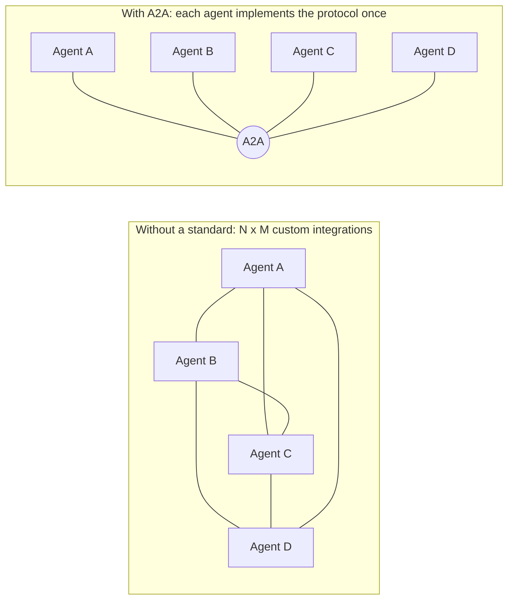
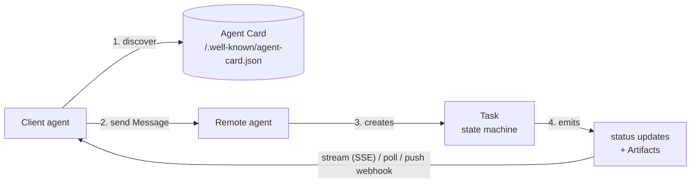
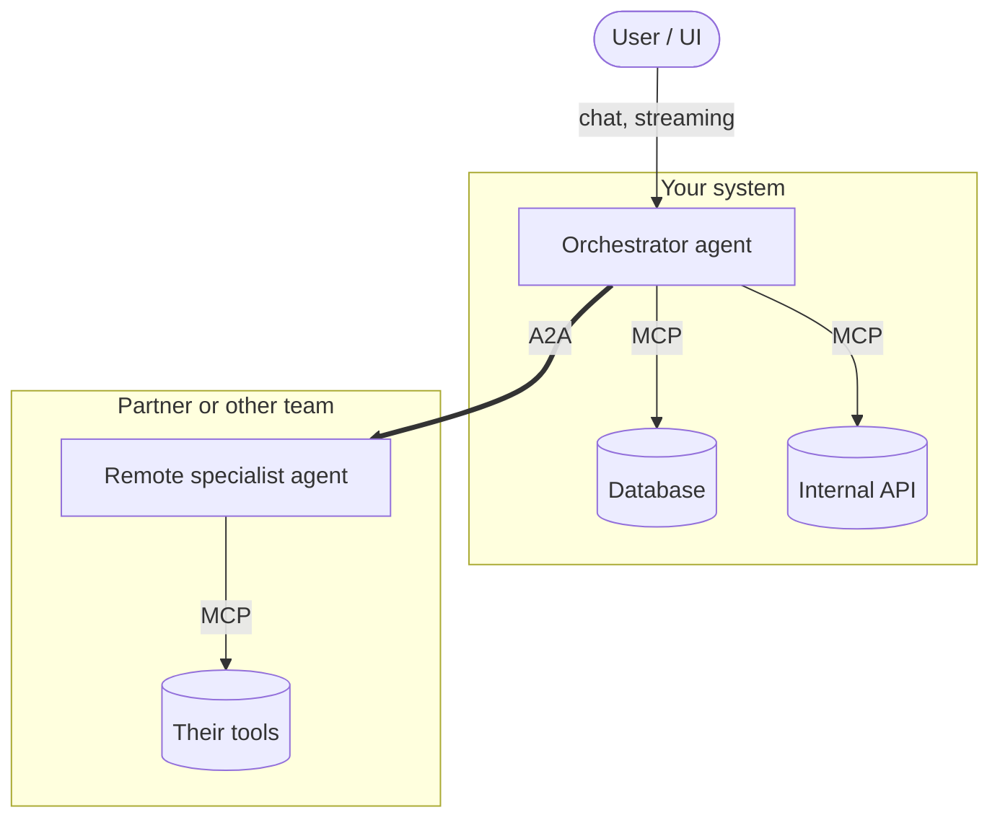
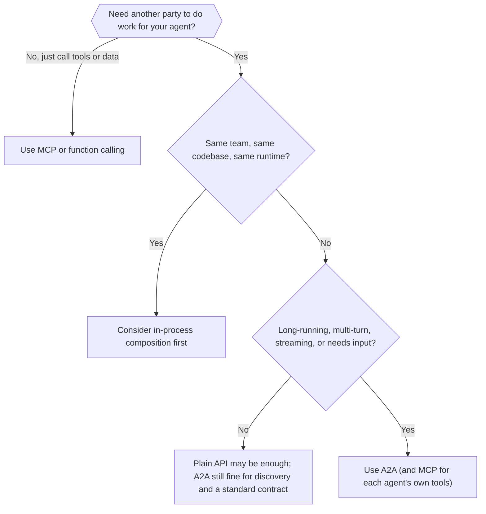

# 07 · A2A explained: what it is, why it matters, when to use it, and how to use it well

> Audience: engineers, architects and technical decision-makers who are new to the **Agent2Agent (A2A) protocol**.
> Facts about the ecosystem were researched in October 2026; the protocol is moving fast, so check the sources at the end.
> This repository is a working example of everything described here: see [01-architecture-overview.md](01-architecture-overview.md).

---

## 1. The short version

- **A2A is an open protocol that lets independently built AI agents find each other, delegate work and collaborate**, even when they come from different vendors, frameworks, languages and organisations.
- Agents stay **opaque**: they exchange *tasks*, *messages* and *artifacts*, not their internal memory, prompts or tools.
- It is built on **web standards** (HTTP, JSON-RPC 2.0, Server-Sent Events, and in v1.0 also gRPC and REST bindings), so it fits existing gateways, load balancers and identity systems.
- It is **complementary to MCP**: MCP connects *an agent to its tools and data*; A2A connects *agents to each other*.
- It is **stable and governed neutrally**: v1.0 (March 2026) is the first stable specification, and since August 2026 the project is hosted by the Linux Foundation's Agentic AI Foundation, alongside MCP.
- Use it when work crosses a **trust or ownership boundary** or needs a **long-running, multi-turn** interaction. Do **not** use it for simple tool calls or when everything lives in one codebase.

---

## 2. Why A2A exists

Agents are being built everywhere: by different teams, with different frameworks (LangGraph, CrewAI, Spring AI, custom code), on different clouds, and increasingly by *different companies*. Without a shared protocol, every pair of agents needs a bespoke integration:

The problems A2A addresses:

| Problem | What A2A provides |
|---|---|
| "What can that agent do, and how do I call it?" | **Agent Card**: a machine-readable self-description at a well-known URL |
| "My request takes minutes or needs a human answer" | **Task** with a lifecycle (`working`, `input-required`, ...), streaming and push notifications |
| "Agents use different frameworks and languages" | One wire protocol; SDKs in Python, JavaScript, Java, Go and .NET |
| "I don't want to expose my agent's internals" | **Opaque execution**: only messages and artifacts cross the boundary |
| "Different modalities and result shapes" | **Parts** (text, structured data, files) and **Artifacts** |
| "Enterprise security and multi-tenancy" | Standard auth schemes, **signed Agent Cards**, tenant scoping, version negotiation (v1.0) |

---

## 3. Where A2A came from (and where it lives now)

| When | What happened |
|---|---|
| April 2025 | Google introduces A2A with 50+ launch partners |
| June 2025 | Donated to the Linux Foundation |
| August 2025 | IBM's competing Agent Communication Protocol (ACP) merges into A2A |
| March 2026 | **v1.0**, the first stable specification: multi-protocol bindings, multi-tenancy, signed Agent Cards, modernised security flows, a migration path from earlier versions |
| April 2026 | 150+ supporting organisations (including AWS, Cisco, Google, IBM, Microsoft, Salesforce, SAP, ServiceNow); production use reported in supply chain, financial services, insurance and IT operations; support inside Microsoft's Azure AI Foundry / Copilot Studio and AWS Bedrock AgentCore Runtime |
| August 17, 2026 | A2A becomes a hosted project of the **Agentic AI Foundation (AAIF)**, the Linux Foundation body that also hosts MCP, goose and AGENTS.md |

Practical meaning: it is an open, Apache-2.0 licensed standard under neutral governance, with first-party cloud support. That lowers the risk of betting on it, though (as with any young standard) details still evolve.

---

## 4. Core concepts

| Concept | Meaning | In this demo |
|---|---|---|
| **Client agent / remote agent** | The agent that asks, and the agent that does the work. A single agent can be both | The orchestrator is a *server* to the UI and a *client* to the three specialists |
| **Agent Card** | JSON document describing identity, endpoint(s), capabilities (streaming, push), skills, supported modes and security | `GET /.well-known/agent-card.json` on every agent; shown in the **Agent cards** tab |
| **Skill** | A capability listed on the card (id, description, examples) | `search_flights`, `find_hotels`, `plan_activities`, `plan_trip` |
| **Message** | One turn of communication, with a role (user/agent) and one or more Parts | The chat text; agents' progress lines |
| **Part** | A unit of content: text, structured data, or a file | `TextPart` summaries and `DataPart` JSON options |
| **Task** | The unit of work with an id, a context id and a lifecycle | One trip request = one orchestrator task + three sub-tasks |
| **Context** | Groups related tasks and messages into one conversation | `contextId` carried across follow-ups |
| **Artifact** | A result produced by a task (can be streamed in chunks) | `flight-options`, `hotel-options`, `activity-plan`, `trip-plan` |
| **Task states** | `submitted`, `working`, `input-required`, `auth-required`, `completed`, `failed`, `canceled`, `rejected` | Timeline tab; see [02-a2a-protocol-flows.md](02-a2a-protocol-flows.md) |

### Three ways to get results
1. **Blocking**: send, wait, receive the final task.
2. **Streaming (SSE)**: receive status and artifact updates as they happen. Best for interactive UIs.
3. **Push notifications (webhooks)**: send and disconnect; the remote agent calls you back. Best for long-running work.

### Protocol bindings (v1.0)
The same operations are defined over **JSON-RPC 2.0 over HTTP** (the one this demo uses), **gRPC**, and **HTTP/REST**. An Agent Card lists which bindings an agent supports, so clients pick one they can speak.

---

## 5. A2A and its neighbours

### A2A vs MCP (they are layers, not rivals)

| | **MCP** (Model Context Protocol) | **A2A** (Agent2Agent) |
|---|---|---|
| Connects | An agent/LLM application to **tools, data and prompts** | An agent to **other agents** |
| Direction | Vertical (agent down to capabilities) | Horizontal (peer to peer) |
| Typical unit | Tool call or resource read: short, predictable | **Task** with a lifecycle: possibly long, multi-turn |
| What the other side is | A deterministic capability described by a schema | An autonomous collaborator that may reason, ask questions and take time |
| Trust boundary | Usually inside your own system | Often **across** teams, vendors or companies |

A common production shape: **each agent uses MCP for its own tools, and agents talk to each other over A2A.**

### A2A vs the alternatives

| Approach | Good for | Why you might outgrow it |
|---|---|---|
| **Function calling / tool use** | One model calling deterministic functions | The "tool" is actually an autonomous agent that needs minutes, questions or progress updates |
| **Plain REST/gRPC API** | Stable, well-defined services | No standard for task state, streaming progress, `input-required`, artifacts or discovery of *agent* capabilities; you reinvent them per integration |
| **In-process multi-agent frameworks** (one codebase) | Agents owned by one team in one runtime | Cannot cross process, language, vendor or organisation boundaries; no standard contract between teams |
| **Message queues / events** | Decoupled async pipelines | No task semantics, discovery or conversational continuation out of the box (and they combine fine with A2A) |
| **A2A** | Cross-boundary agent collaboration with stateful, long-running tasks | Overhead you do not need for simple, single-owner workflows |

---

## 6. Benefits

**For the business**
- **Avoid vendor and framework lock-in.** Swap an agent for a better one without rewriting callers, as long as it speaks A2A.
- **Compose capabilities across teams and partners.** Buy or borrow a specialist agent instead of rebuilding it.
- **Governance by a neutral body** and first-party support from the major clouds reduces strategic risk.

**For architects**
- **Clear contracts.** The Agent Card and task model give every integration the same shape: discovery, auth, state, results.
- **Independent scaling and ownership.** Each agent is its own deployable with its own lifecycle, team and scaling profile.
- **Opaque by design.** Agents expose behaviour, not internals, which limits blast radius and protects intellectual property.
- **Web-native.** Works with existing API gateways, TLS, OAuth/OIDC, rate limiting and observability tooling.

**For developers**
- **Interop out of the box.** A Java agent can delegate to a Python or JS agent with no glue code.
- **Good UX primitives.** Streaming progress, partial artifacts and `input-required` make rich, responsive agent UIs possible (this demo's timeline and graph are built on exactly these).
- **Mature SDKs** in five languages, so you rarely touch the wire format.
- **Testable.** Because the contract is explicit, you can test an agent with a plain HTTP client (see [06-testing.md](06-testing.md)).

---

## 7. Applicability: when A2A fits

### Strong fits
- **Cross-organisation collaboration**: your agent delegates to a supplier's, partner's or marketplace agent.
- **Cross-team platforms**: many teams publish agents that others compose (an internal "agent mesh").
- **Heterogeneous stacks**: agents in different languages or frameworks must work together.
- **Long-running or human-in-the-loop work**: approvals, clarifying questions, work that takes minutes to days.
- **Specialist delegation**: an orchestrator routes sub-tasks to expert agents (travel, research, compliance, procurement, IT operations, supply chain).
- **Streaming UX**: you want users to see progress and partial results.

### Weak fits (use something simpler)
- **One agent calling tools or APIs.** Use MCP or plain function calling.
- **A single codebase and team.** An in-process framework has less overhead and fewer failure modes.
- **Strictly synchronous, sub-second, deterministic calls.** A normal API is faster and simpler.
- **Heavy data movement.** Pass references (URLs, object-store keys) in artifacts; do not push gigabytes through messages.

### Decision guide

### Maturity check (as of October 2026)
- **Spec:** v1.0 stable (a v1.0.x patch line exists); earlier versions (e.g. 0.3) use different wire shapes, so confirm which version a peer speaks.
- **Ecosystem:** 150+ organisations, five official SDK languages, cloud-provider support, an agent-payments extension (AP2).
- **Still developing:** the project roadmap lists an interoperability specification, registry and discovery consolidation, more testing tooling, and security/deployment best practices. One analysis (June 2026) reported that the protocol itself does not define human escalation or audit replay, so those guardrails belong in your application layer.

---

## 8. Do's and don'ts

### 8.1 Design

**Do**
1. **Model real work as tasks.** If it can take time, pause for input, or produce multiple results, it is a task, not a request/response.
2. **Give every agent one clear job and a precise Agent Card.** Specific skill descriptions and examples let other agents (and humans) choose correctly.
3. **Treat `input-required` as a normal, first-class path**, not an error. Keep the task, let the user answer, continue the *same* task id. (Demo: "Input required" and "Relayed question" scenarios.)
4. **Separate essential from optional collaborators.** Fail the task if a required agent fails; degrade gracefully if an optional one does. (Demo: "Partial failure" vs "Rejected".)
5. **Return structured results as well as prose.** Pair a human-readable `TextPart` with a machine-readable `DataPart` so downstream agents don't have to parse sentences.
6. **Stream progress** for anything longer than a couple of seconds, and use **push notifications** for work that outlives the connection.
7. **Make cancellation propagate.** If you delegated work and the caller cancels, cancel the sub-tasks too. (Demo: the Cancel button.)
8. **Persist task state in production** (database-backed stores, durable queues) so a restart does not lose in-flight work.
9. **Version deliberately.** Advertise the protocol version you implement and handle peers on other versions. Send the `A2A-Version` header on every call: a v1.0 server treats a missing header as 0.3 and may reject you.

**Don't**
1. **Don't use A2A where a function call will do.** Wrapping every tool in an "agent" adds latency, cost and failure modes.
2. **Don't create a fleet of tiny agents** that each do one trivial step. Every hop is a network call, a task to track and a place to fail. Group related capabilities.
3. **Don't drive control flow by parsing free text** from another agent. Use states, structured data parts and explicit fields.
4. **Don't block synchronously on long tasks.** Use streaming, polling or push.
5. **Don't leak internals** (prompts, chain-of-thought, tool lists, other customers' data) in messages or artifacts. Opacity is a feature; keep it.
6. **Don't rely on in-memory stores or single instances** for anything you care about (the demo does, deliberately).

### 8.2 Security and trust

**Do**
1. **Authenticate and authorise every call.** Declare the security schemes on the Agent Card (OAuth 2.0/OIDC, API keys, mTLS) and enforce them server-side.
2. **Verify who you are talking to.** Prefer **signed Agent Cards** and pin or allow-list the agents you delegate to.
3. **Treat everything a remote agent returns as untrusted input.** Messages and artifacts can carry **prompt injection** aimed at *your* agent's LLM. Validate, sanitise and constrain what your agent does with them.
4. **Apply least privilege and scope data.** Send a remote agent only what it needs; use tenant scoping and per-agent credentials; keep secrets out of messages.
5. **Validate push-notification URLs and authenticate callbacks** (token or signature). Push configuration lets a caller make *your* server send HTTP requests, which is an SSRF risk.
6. **Rate-limit and budget.** Cap concurrent tasks, depth of delegation chains and per-caller cost to prevent runaway loops and denial of wallet.
7. **Log with task and context ids** and keep an audit trail of who delegated what to whom.

**Don't**
1. **Don't trust an unsigned Agent Card's claims** (skills, owner, endpoints) just because it is served from a URL.
2. **Don't forward the end user's credentials** to downstream agents. Exchange or scope tokens instead (avoid the confused-deputy problem).
3. **Don't leave diagnostic endpoints open.** This demo's `/trace/stream` and `ALLOW_ALL` push-URL validator are for localhost only.
4. **Don't let an agent chain act without limits.** Always bound depth, time and spend.
5. **Don't assume protocol-level human oversight.** If a workflow needs approvals or replayable audit, build it explicitly.

### 8.3 Operations and quality

**Do**
1. **Set timeouts and retries per hop**, and make delegated operations idempotent where you can.
2. **Test the unhappy paths**: rejection, failure, cancellation, `input-required`, slow agents, malformed artifacts. (Demo: the end-to-end suite covers each.)
3. **Test against the real wire format**, not only through your own SDK on both ends.
4. **Monitor per-agent latency, failure rates and task-state distributions**; propagate trace ids across hops.
5. **Use the SDKs** instead of hand-rolling JSON-RPC, and pin their versions.
6. **Document each agent** (card description, examples, limits, owner, support contact).

**Don't**
1. **Don't ship without a failure-injection test** for every external agent you depend on.
2. **Don't hard-code peer URLs everywhere.** Keep them in configuration or a registry so agents can move.
3. **Don't assume peers are as fast, available or deterministic as your own code.** Design for slow, flaky and creative.
4. **Don't mix protocol versions silently.** Pin and test the versions you interoperate with.

---

## 9. Risk summary

| Risk | Why it happens | Mitigation |
|---|---|---|
| Prompt injection via artifacts/messages | A remote agent's output flows into your agent's context | Treat as untrusted; validate and constrain; separate data from instructions |
| Impersonation | Anyone can host an Agent Card | Signed cards, allow-lists, mutual TLS |
| SSRF via push webhooks | Callers supply callback URLs | URL validation, egress controls, token-checked callbacks |
| Data leakage | Over-sharing context with a delegate | Minimal context, tenant scoping, redaction |
| Runaway cost / loops | Agents delegating to agents | Depth, time and budget limits; quotas |
| Lost work on restart | In-memory state | Durable task store and queues |
| Version drift | v0.3 vs v1.0 differences, extension skew | Version negotiation, pinned SDKs, contract tests |
| Over-engineering | Using A2A where a call would do | Use the decision guide in section 7 |

---

## 10. Getting started checklist

1. **Decide the boundary.** Which capabilities should be separate agents, owned by whom? (Section 7.)
2. **Write the Agent Card first**: skills, examples, modes, security schemes.
3. **Pick an SDK** for your language and implement the executor: `submit`, `working`, `input-required`, artifacts, `complete` / `fail` / `reject`, `cancel`.
4. **Choose delivery per use case**: streaming for UIs, push for long jobs.
5. **Add security** before exposing anything beyond localhost.
6. **Test every state transition** over the real wire.
7. **Instrument**: trace ids, per-agent metrics, an audit trail.
8. **Run this demo** to see the moving parts: scenarios in the UI map one-to-one to the concepts in section 4.

---

## 11. Demo cheat-sheet: concept to scenario

| A2A concept | Where to see it in this project |
|---|---|
| Discovery | "Agent cards" tab; `GET /.well-known/agent-card.json` |
| Streaming | Happy path: progress lines and timeline |
| Parallel delegation | Graph: three edges light up at once |
| Artifacts with structured data | Trip plan card; Wire log shows `artifactUpdate` |
| Streamed artifact chunks | Activities plan arrives day by day |
| `input-required` | "Input required" scenario |
| Relayed `input-required` | "Relayed question" scenario |
| `failed` / `rejected` | "Partial failure" / "Rejected" scenarios |
| Cancellation (propagated) | Cancel button; sub-tasks end `canceled` |
| `GetTask`, `ListTasks`, `SubscribeToTask` | Tasks tab; refresh mid-run to re-attach |
| Push notifications | "background (push)" toggle |
| Raw wire format | Wire log tab |

---

## 12. Glossary

- **A2A**: Agent2Agent protocol. **AAIF**: Agentic AI Foundation (Linux Foundation). **MCP**: Model Context Protocol.
- **Agent Card**: JSON self-description of an agent, served at `/.well-known/agent-card.json`.
- **Task / Context / Artifact / Part / Message**: see section 4.
- **SSE**: Server-Sent Events, the streaming mechanism used for `SendStreamingMessage` and `SubscribeToTask`.
- **Push notification**: a webhook call from the remote agent to the client about task updates.
- **Opaque execution**: collaborators see inputs and outputs, not each other's internals.
- **Prompt injection**: untrusted text that tries to steer an LLM into unintended actions.

---

## Sources (checked October 2026)

- Linux Foundation press release, "A2A Protocol Surpasses 150 Organizations..." (April 9, 2026): v1.0 features, adoption, SDK languages, cloud support, AP2, MCP relationship, roadmap.
- Axios, "Google-backed agentic A2A protocol gets a new home" (August 17, 2026), and Techzine's report on the transfer: move to the Agentic AI Foundation, timeline (April 2025 launch, June 2025 Linux Foundation donation, 50+ launch partners).
- Pebblous analysis (August 2026): v1.0 release in March 2026, IBM ACP merger in August 2025, AAIF formation on December 9, 2025.
- ai2.work summary (2026): reported June 2026 governance-gap analysis (human escalation and audit replay are application-level concerns). Treat as a secondary source.
- Official specification and documentation: https://a2a-protocol.org/ (spec, SDK reference, roadmap, 1.0 announcement); source at https://github.com/a2aproject/A2A; Java SDK at https://github.com/a2aproject/a2a-java.
