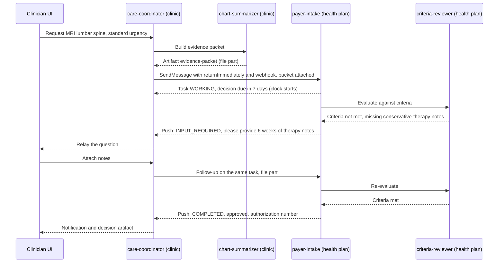
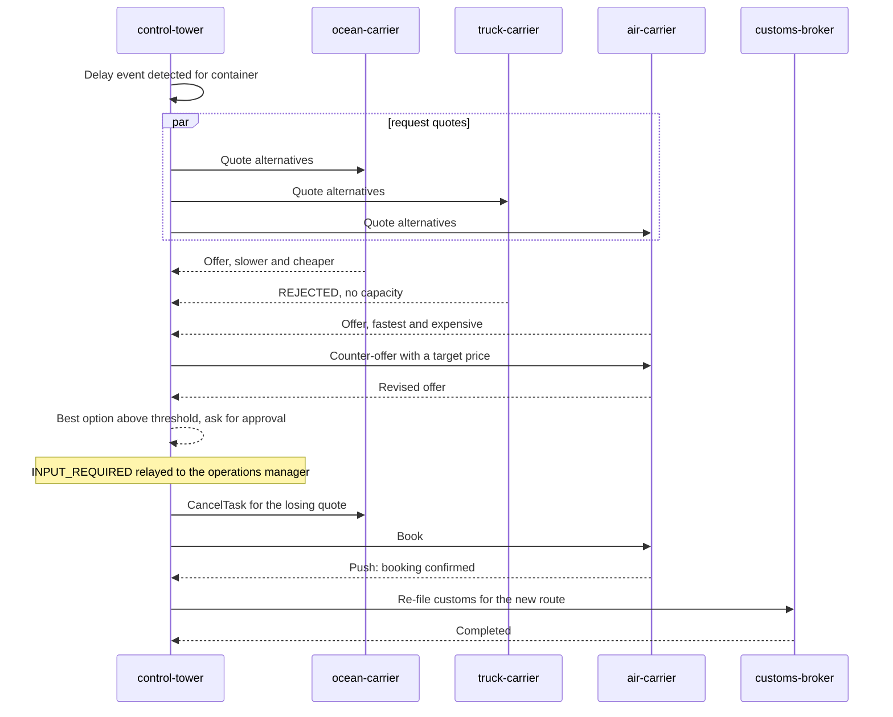
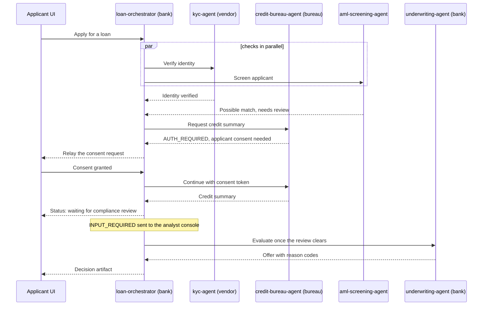
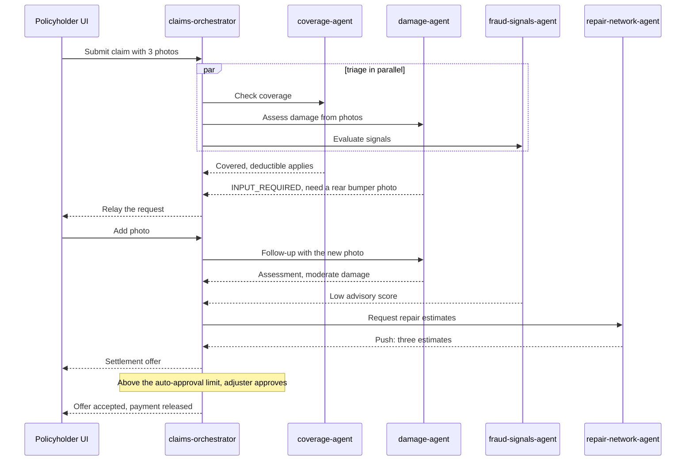
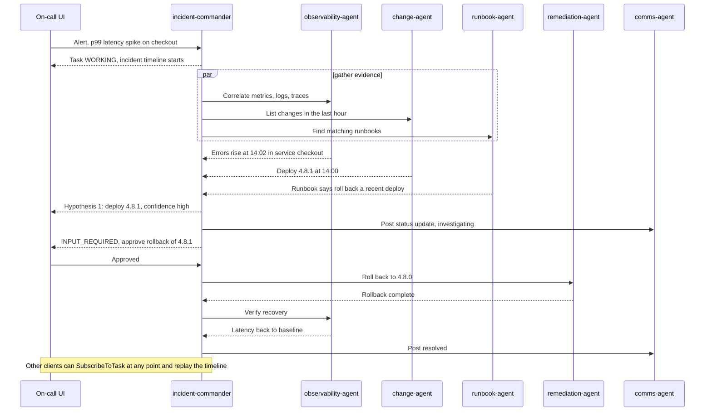
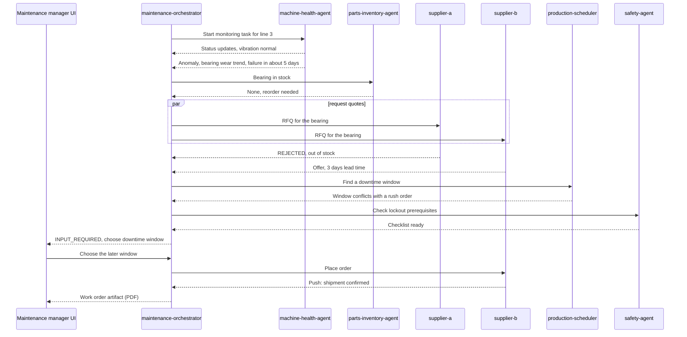
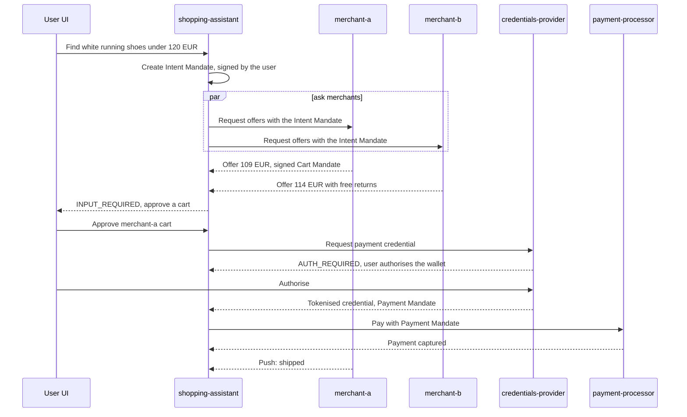
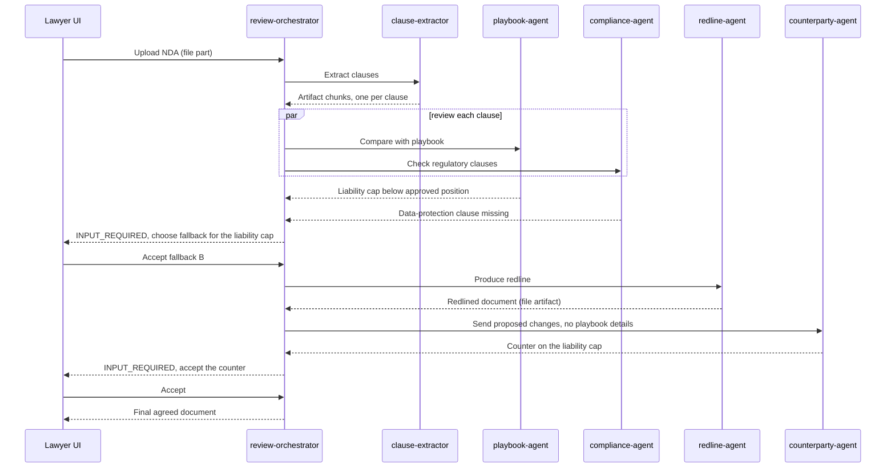

# 08 · A2A demo concepts for other domains

> **Status:** planning document. Nothing here is implemented yet. It is written so that each concept can later be estimated,
> approved and built as its own chunk on top of this repository (Spring Boot 4 agents, Java A2A SDK 1.3, Next.js UI).
> **All scenarios are illustrative.** Industry details are simplified, every dataset would be **synthetic**, and nothing here is
> legal, medical, financial or compliance advice.

---

## 1. Why these concepts

The travel demo proves the mechanics. A domain demo has a different job: show *why* a business would put agents from different
owners behind a standard protocol. Every concept below was chosen against four tests:

1. **It crosses a trust or ownership boundary.** At least two organisations (or a regulated and an unregulated side) are involved, so
   "opaque agents over a standard protocol" is the point, not a detail.
2. **It needs more than request/response.** Long-running work, a human decision, negotiation, or progress someone wants to watch.
3. **It teaches something the travel demo does not.** Each concept has a *headline A2A feature* that is different from the others.
4. **It can be built with simulated agents.** No LLM, API key or real data is required to make the story work (an LLM can replace a
   simulated agent later without changing the protocol).

### The A2A capabilities used (all in A2A v1.0 and modelled by the Java SDK 1.3)
Streaming (SSE) · push notifications (webhooks) · `input-required` · `auth-required` · `rejected` / `failed` / `canceled` ·
`CancelTask` · `GetTask` / `ListTasks` / `SubscribeToTask` (re-attach, many viewers) · artifacts with text, structured-data and
**file** parts, optionally streamed in chunks · contexts (multi-turn continuity) · Agent Card skills · security schemes (OAuth 2,
OIDC, mTLS, API key) · extensions · the authenticated extended card · multi-tenancy (SDK extra) · OpenTelemetry (SDK extra).
*Signed Agent Cards:* the protocol defines them and the SDK models the type, but whether the SDK verifies signatures should be
checked before a demo relies on it (flagged where it matters).

---

## 2. The eight concepts at a glance

| # | Domain | Demo name | Headline A2A feature | Other features | Size | Wow |
|---|---|---|---|---|---|---|
| D-1 | Healthcare | **PriorAuth Navigator** | Push notifications against a decision clock (SLA) | `input-required` for documents, file parts, cross-org trust | M-L | ★★★★★ |
| D-2 | Logistics | **Exception Control Tower** | Multi-agent negotiation + cancellation propagation | Parallel quotes, approval threshold, push confirmations | M | ★★★★ |
| D-3 | Financial services | **Lending Desk** | `auth-required` consent and cross-org trust (signed cards, mTLS, tenants) | `rejected`, human review, push | M-L | ★★★★ |
| D-4 | Insurance | **Claims Swarm** | Image/file parts in and out | Fan-out, `input-required`, push from garages | M | ★★★★ |
| D-5 | IT operations | **Incident Room** | Long-lived task with many viewers (`SubscribeToTask`) | Streaming, gated remediation, OpenTelemetry link | M | ★★★★★ |
| D-6 | Manufacturing | **Plant Floor Pit Crew** | Long-running monitoring task with event-driven escalation | Supplier negotiation, downtime approval | M-L | ★★★ |
| D-7 | Retail | **Smart Cart** | A2A extension in practice (AP2 mandates) | Fan-out, personalised offers, `auth-required` | L | ★★★★★ |
| D-8 | Legal | **Clause Desk** | File parts + chunked artifacts, counterparty negotiation | `input-required` for the lawyer, privilege boundary | M | ★★★★ |

Two more are sketched in section 7: **Energy** (grid balancing) and **Recruiting** (screening and scheduling).

Size guide (rough, for one engineer on this repo, including simulated agents, UI scenarios, tests and docs; the Java backend is
not yet compiled, so add time for the first real build): **S** 2-3 days, **M** 5-8 days, **L** 10-15 days.

---

## 3. Feature coverage matrix

`●` = a headline or central feature of the demo · `○` = used, but in a supporting role · blank = not used.

| A2A capability | D-1 Health | D-2 Logistics | D-3 Finance | D-4 Insurance | D-5 IT ops | D-6 Mfg | D-7 Retail | D-8 Legal |
|---|---|---|---|---|---|---|---|---|
| Streaming progress | ○ | ○ | ○ | ● | ● | ○ | ○ | ● |
| Push notifications / webhooks | ● | ○ | ○ | ○ | ○ | ○ | ○ | ○ |
| `input-required` (human or user answers) | ● | ○ | ○ | ○ | ● | ● | ● | ● |
| `auth-required` (consent / credentials) | | | ● | | | | ○ | |
| `rejected` / `failed` handling | ○ | ○ | ● | ○ | ○ | ○ | ● | ○ |
| Cancellation propagation | ○ | ● | | ○ | ○ | ○ | | |
| Long-lived task, re-attach, many viewers | ○ | ○ | | | ● | ● | | |
| Parallel fan-out | | ● | ○ | ● | ● | ○ | ● | ○ |
| Multi-turn negotiation between agents | | ● | | ○ | | ○ | ○ | ● |
| File / image parts | ● | ○ | ○ | ● | | ○ | | ● |
| Chunked (streamed) artifacts | | | | ○ | ○ | | | ● |
| Cross-organisation trust (security schemes, mTLS, signed cards) | ● | ○ | ● | ○ | | ○ | ○ | ● |
| Extension | | | | | | | ● | |
| Multi-tenancy | | ○ | ● | | | | | ○ |

**Distinctness check for the four leading demos** (the ones recommended to build first): each has a headline feature none of the
others uses as its headline.

| Demo | Headline | No other leading demo leads with it |
|---|---|---|
| D-1 Healthcare | push notifications against an SLA clock | yes |
| D-2 Logistics | negotiation + cancellation propagation | yes |
| D-3 Finance | `auth-required` + cross-org trust | yes |
| D-5 IT operations | long-lived task, many viewers | yes |

---

## 4. Recommended build order (and why)

| Order | Demo | Reasoning |
|---|---|---|
| 1 | **D-2 Logistics** | Highest reuse: parallel fan-out and cancellation propagation already exist in the orchestrator. New: negotiation rounds and an approval threshold. Lowest domain risk, so it proves the "domain pack" structure cheaply |
| 2 | **D-5 IT operations** | Reuses the timeline, wire log and tasks panel almost unchanged. Adds the one thing the repo only touched lightly: a long-lived task that several viewers attach to. Natural link to the SDK's OpenTelemetry extra |
| 3 | **D-1 Healthcare** | Biggest story value. Needs the push-notification path (already built) plus an accelerated SLA clock and file parts. Regulatory timing makes it timely (see its section) |
| 4 | **D-3 Finance** | Adds `auth-required`, mTLS/OAuth between organisations and tenants, which are the pieces enterprises ask about. Best built after the simpler cross-org demos |
| 5 | **D-4 Insurance** | Introduces image parts; reuses D-1's file handling and D-2's fan-out |
| 6 | **D-8 Legal** | Chunked artifacts and counterparty negotiation; reuses D-2 negotiation and D-4 file handling |
| 7 | **D-6 Manufacturing** | Needs a telemetry simulator and a long-running monitor; reuses D-5's subscription UI |
| 8 | **D-7 Retail / AP2** | Largest, because the AP2 extension (mandates, credentials provider) is new work. Build last, with mock signatures first |

---

## 5. Shared building blocks to extract from this repo first

Building eight demos by copy-paste would multiply the work. Before the second demo, extract these (each is a separate small chunk):

| Block | Today | Extract as |
|---|---|---|
| Spring wiring for the SDK, controller, trace tap | `a2a-spring-support` | Keep as is. Already domain-neutral |
| Orchestration core: per-task state, parallel calls, relayed `input-required`, cancellation propagation | `OrchestratorExecutor`, `RemoteCall`, `TripState` | `a2a-orchestration-kit`: a generic `CaseState` and a small DSL for "call these agents, then decide" |
| Simulated-agent helpers | `AgentSupport`, `TripRequest` | `a2a-sim-kit`: `pause`, `progress`, `artifact`, deterministic data generators seeded by case id |
| Agent graph, timeline, wire log, tasks, cards | Next.js components with four hard-coded nodes | Data-driven: nodes, colours, ports and scenario chips come from a `domain.config.ts` |
| Theme system | `globals.css` tokens + `ThemeToggle` | Reused unchanged (soft charcoal and cream, never pitch black or pure white) |
| Push hub and webhook routes | `push-hub.ts`, `/api/push/*` | Reused unchanged |
| Test harness | `TestStack`, `A2ATestClient`, `Node`, `mock-a2a.ts`, theme guard tests | Parameterised by a list of agents |
| Version and header guards | `SpringBootVersionTest`, `A2A-Version` header test | Reused unchanged |

Proposed layout once extracted:

```
domains/
  logistics/   agents/  scenarios.json  README.md
  it-ops/      agents/  scenarios.json  README.md
  healthcare/  ...
platform/
  a2a-spring-support/  a2a-orchestration-kit/  a2a-sim-kit/  ui-shell/
```

---
## 6. The concepts in depth

### D-1 · Healthcare: **PriorAuth Navigator** (prior authorization and care coordination)

#### Scenario and why multi-agent
A clinic orders an MRI. The patient's health plan must approve it first (prior authorization). Today this is phone, fax and portals.
Two organisations, regulated health data, a human decision on one side, and a decision that arrives hours or days later: a textbook
A2A case.

Real-world timing makes it concrete (US, CMS Interoperability and Prior Authorization final rule, CMS-0057-F): since **January 1, 2026**
impacted payers must decide **urgent requests within 72 hours and standard requests within 7 calendar days** and give a specific reason for
denials; their **FHIR-based Prior Authorization API** is due **January 1, 2027**. The demo can mimic that clock (accelerated) without implementing FHIR.

**Trust boundary:** clinic (provider) to health plan (payer). Neither side exposes its internal systems; only the request, the evidence
and the decision cross the line.

#### Agent roster
| Agent | Owned by | Skill | Notes |
|---|---|---|---|
| `care-coordinator` | Clinic | Submit and track prior-auth requests | The orchestrator: A2A server to the clinician UI, A2A client to the others |
| `chart-summarizer` | Clinic | Build the clinical evidence packet from the (synthetic) chart | Produces a file artifact |
| `payer-intake` | Health plan | Accept requests, check completeness, own the case clock | Long-running tasks; the decision arrives by push |
| `criteria-reviewer` | Health plan | Apply the plan's medical-necessity criteria | Recommends approve / pend / deny; **never** the final denial |
| Reviewer console (human) | Health plan | Sign off denials | Shown as a small UI panel in the demo |

#### A2A features showcased
- **Headline: push notifications against a decision clock.** The clinic submits with `returnImmediately` and a webhook, disconnects, and is called back when the plan decides.
- `input-required` when the plan needs more documentation (the clinician answers with a file).
- **File parts:** the evidence packet and the added notes travel as files (URI or bytes), not pasted text.
- Cross-organisation security: OAuth 2 or mTLS declared on the payer card; `rejected` for out-of-scope requests.
- `ListTasks` / `GetTask` so the clinic can see every open request and its time remaining.

#### Flow


#### Data and artifacts
```json
{
  "kind": "pa-request",
  "patient": "synthetic-0042",
  "service": { "description": "MRI lumbar spine without contrast", "cpt": "72148" },
  "diagnosis": { "icd10": "M54.50" },
  "urgency": "standard",
  "clock": { "submittedAt": "2027-02-01T09:00:00Z", "decisionDueBy": "2027-02-08T09:00:00Z" }
}
```
```json
{
  "kind": "pa-decision",
  "status": "approved",
  "authorizationNumber": "SYN-7731",
  "criteria": [
    { "id": "conservative-therapy-6w", "met": true, "evidence": "therapy-notes.pdf" }
  ],
  "decidedBy": "criteria-reviewer",
  "humanSignOffRequired": false
}
```
(Codes are illustrative and deliberately synthetic.)

#### Guardrails
- **Synthetic data only.** No real patient data, ever, in the demo, its logs, screenshots or trace tap.
- **Minimum necessary:** the clinic sends only the evidence the criteria need; the trace UI masks identifiers by default.
- **Humans decide denials.** The agent may recommend; a denial needs a reviewer's sign-off and a specific reason.
- **Clock integrity:** the decision deadline is computed by the payer agent and shown, never guessed by the client.
- **Auditability:** every task carries ids and a trace link; keep a decision log.
- Webhook hardening (token, URL allow-list): the clinic's callback URL is attacker-controlled input from the payer's point of view.

#### Build estimate on this stack
**Size M-L.** Reuse: orchestrator and relayed `input-required`, push hub and webhook routes, tasks panel, theme, trace UI, test harness.
New: synthetic chart and criteria generator, file artifacts served from a static folder, the accelerated clock widget, the reviewer panel,
a second "organisation" boundary (two agent groups with separate cards and credentials).

#### Demo script
1. **Fast path:** criteria met, approved within the first minute; the clinic sees streaming progress.
2. **Pended then approved:** missing notes, `input-required`, clinician attaches a file, the approval arrives by push after the page was closed and reopened (re-attach).
3. **Failure path:** the plan denies with a specific reason after reviewer sign-off; the clinic withdraws the request (`CancelTask`) and the plan's task ends `canceled`. Bonus: the accelerated clock passes its deadline and the clinic agent escalates.

---

### D-2 · Logistics: **Exception Control Tower** (shipment disruption handling)

#### Scenario and why multi-agent
A container is stuck at a congested port. The shipper's control tower must find an alternative, get quotes from several carriers
that are different companies, re-file customs paperwork and re-slot the warehouse dock. Each party guards its own pricing and
capacity, and the tower should not leak one carrier's quote to another.

Realistic data models to imitate (not to implement): **GS1 EPCIS** (supply-chain events), **DCSA** standards (container shipping track and
trace) and **IATA ONE Record** (air cargo data).

**Trust boundary:** shipper to several independent carriers and a customs broker.

#### Agent roster
| Agent | Owned by | Skill |
|---|---|---|
| `control-tower` | Shipper | Detect the exception, run the recovery, own the decision |
| `ocean-carrier`, `truck-carrier`, `air-carrier` | Three carriers | Quote and book capacity; counter-offer |
| `customs-broker` | Broker | Re-file declarations for the new route |
| `warehouse` | Shipper's 3PL | Re-slot dock appointments |

#### A2A features showcased
- **Headline: negotiation plus cancellation propagation.** Quotes run as multi-turn tasks in the same context; when one carrier wins, the tower sends `CancelTask` to the losing quote tasks.
- Parallel fan-out to three carriers (already in this repo).
- `input-required` when the best option exceeds the spending threshold: a human approves.
- Push confirmations when a carrier confirms the booking later.
- `rejected` when a carrier has no capacity; the tower falls back.

#### Flow


#### Data and artifacts
```json
{
  "kind": "carrier-quote",
  "carrier": "air-carrier",
  "mode": "air",
  "etaHours": 36,
  "price": { "amount": 4200, "currency": "EUR" },
  "validUntil": "2026-11-03T18:00:00Z",
  "capacityKg": 1200,
  "bookingRef": null
}
```

#### Guardrails
- **Spending policy:** automatic below a threshold, human approval above it; the policy is data, shown in the UI.
- **Opaque agents by design:** the tower sends a target price, never a competitor's quote.
- **Idempotent booking:** a booking reference prevents double bookings when a call is retried.
- **Carrier identity:** Agent Card allow-list and mTLS; treat a carrier's artifacts as untrusted input.
- **Data minimisation:** no customer personal data to carriers; customs data only to the broker.

#### Build estimate on this stack
**Size M.** Reuse: fan-out, cancellation propagation, relayed `input-required`, graph, timeline, push hub.
New: three carrier simulators with different personalities (cheap and slow, fast and pricey, sometimes rejects), a negotiation loop, a
policy threshold, a route graph widget.

#### Demo script
1. **Within policy:** three quotes, a counter-offer, automatic booking, losing quote cancelled.
2. **Above threshold:** the tower pauses in `input-required`, the manager approves, booking proceeds, confirmation arrives by push.
3. **Failure path:** the preferred carrier rejects at booking time; the tower falls back to the second option and cancels the rest.

---
### D-3 · Financial services: **Lending Desk** (loan origination with KYC and AML)

#### Scenario and why multi-agent
A bank processes a personal-loan application. Identity verification, the credit bureau and sanctions/AML screening are separate
companies or separate regulated functions. The applicant's consent is required before a credit pull, and a screening hit needs a
human analyst. Different owners, strict identities, regulated decisions.

**Trust boundary:** bank to identity vendor, credit bureau and screening provider; and bank brand A to bank brand B when the same
platform serves several institutions (tenants).

#### Agent roster
| Agent | Owned by | Skill |
|---|---|---|
| `loan-orchestrator` | Bank | Run the application end to end, own the decision record |
| `kyc-agent` | Identity vendor | Verify identity documents and liveness result (simulated) |
| `credit-bureau-agent` | Credit bureau | Return a credit summary **after consent** |
| `aml-screening-agent` | Compliance provider | Screen against watch lists (simulated), return hits with reasons |
| `underwriting-agent` | Bank | Propose approve / counter / decline with reason codes |
| Analyst console (human) | Bank | Resolve screening hits, approve exceptions and declines |

#### A2A features showcased
- **Headline: `auth-required` consent plus cross-organisation trust.** The bureau task pauses in `auth-required` until the applicant's consent is obtained out of band, then continues.
- Security schemes on every vendor card (OAuth 2 / OIDC, mTLS); signed Agent Cards where the SDK supports verification (to be confirmed before the demo claims it).
- **Multi-tenancy:** the same agents serve two bank brands with isolated tasks (SDK multi-tenancy extra).
- `rejected` for hard policy declines, `input-required` for the analyst, push for the analyst's later decision.

#### Flow


#### Data and artifacts
```json
{
  "kind": "loan-decision",
  "outcome": "approved-with-counter",
  "offer": { "amount": 12000, "currency": "EUR", "termMonths": 36 },
  "reasonCodes": ["DTI-HIGH", "THIN-FILE"],
  "screening": { "result": "cleared", "reviewedBy": "analyst-console" },
  "consent": { "bureauPull": "granted", "grantedAt": "2026-11-02T10:15:00Z" },
  "humanApproval": { "required": true, "by": "analyst-console" }
}
```

#### Guardrails
- **Synthetic applicants only.** No real identities, scores or documents.
- **Explainability:** every adverse outcome carries specific reason codes (adverse-action notices are a legal requirement in many jurisdictions); the agent proposes, a person approves declines and exceptions.
- **Regulatory awareness:** creditworthiness assessment of individuals is typically treated as high-risk under the EU AI Act, and US banks apply model risk management guidance (SR 11-7). The demo should show the controls (human approval, logging, reason codes) without claiming compliance.
- **PII hygiene:** the trace tap masks personal fields; vendors receive only what their check needs.
- **Tenant isolation:** tests that prove brand A can never read brand B's tasks.
- **Consent is explicit and recorded**, with a timestamp and scope, and never inferred by an agent.

#### Build estimate on this stack
**Size M-L.** Reuse: orchestrator, relayed `input-required`, push, tasks panel, theme, test harness.
New: `auth-required` handling in the orchestrator and UI, mTLS or OAuth between agent groups, tenant routing (SDK multi-tenancy extra), the analyst console, PII masking in the trace UI.

#### Demo script
1. **Clean approval:** identity verified, consent given, offer approved.
2. **Consent path:** the credit task sits in `auth-required`; the applicant refuses, the task ends cleanly; the applicant retries and grants consent.
3. **Failure path:** a screening hit goes to the analyst, who declines; the decision carries reason codes. A second variant shows a hard policy decline as `rejected`.

---

### D-4 · Insurance: **Claims Swarm** (claims triage and settlement)

#### Scenario and why multi-agent
After a minor car accident, the policyholder uploads photos. Coverage, damage assessment and fraud signals are independent
specialties, the repair network is external, and small claims should settle quickly while large or doubtful ones need an adjuster.

Data modelling can borrow from industry standards such as **ACORD** (not implemented).

**Trust boundary:** insurer to repair garages and, optionally, to a third-party assessment provider.

#### Agent roster
| Agent | Owned by | Skill |
|---|---|---|
| `claims-orchestrator` | Insurer | Triage, coordinate, own the settlement offer |
| `coverage-agent` | Insurer | Check the policy, deductible and exclusions |
| `damage-agent` | Assessment provider | Assess damage from photos (simulated analysis) |
| `fraud-signals-agent` | Insurer | Return **advisory** signals with reasons |
| `repair-network-agent` | Garage network | Collect repair estimates from several garages |
| `payment-agent` | Insurer | Release payment after approval |

#### A2A features showcased
- **Headline: image and file parts in and out.** Photos go in as file parts; the assessment report and the settlement letter come back as file artifacts.
- Parallel fan-out to coverage, damage and fraud signals.
- `input-required` when photos are insufficient ("please add a photo of the rear bumper").
- Push when garage estimates arrive hours later; streaming assessment progress.
- `rejected` when a loss is not covered.

#### Flow


#### Data and artifacts
```json
{
  "kind": "damage-assessment",
  "severity": "moderate",
  "affectedParts": ["rear bumper", "tail light"],
  "estimateRange": { "min": 900, "max": 1500, "currency": "EUR" },
  "confidence": 0.78,
  "photosUsed": ["front.jpg", "side.jpg", "rear.jpg"]
}
```
```json
{
  "kind": "fraud-signals",
  "advisory": true,
  "score": 0.12,
  "reasons": ["claim timing normal", "photo metadata consistent"],
  "humanReviewRecommended": false
}
```

#### Guardrails
- **No autonomous denial.** Denials and payouts above a limit need an adjuster; fraud scores are **advisory**, explainable and never use protected attributes.
- **Photo privacy:** strip location metadata before sharing with garages; limit retention.
- **Opaque agents:** garages never see the fraud score or coverage details; they see the repair scope only.
- **Audit trail:** which agent said what, with the task id on every artifact.
- Synthetic policies, people and images only (generated placeholder images).

#### Build estimate on this stack
**Size M.** Reuse: fan-out, relayed `input-required`, push, file handling from D-1, theme, trace UI.
New: simulated damage analysis (deterministic from file name and size), photo upload in the UI, garage simulators, adjuster approval step.

#### Demo script
1. **Fast track:** small claim, covered, low fraud score, settled automatically within the limit.
2. **More photos needed:** `input-required`, the user adds a photo, the assessment completes, garage estimates arrive by push.
3. **Failure path:** a high advisory fraud score pauses the task for the adjuster, who cancels automatic settlement (`CancelTask` on the payment task); a non-covered loss ends `rejected` with the exclusion named.

---
### D-5 · IT operations: **Incident Room** (incident response across observability, change, runbooks and remediation)

#### Scenario and why multi-agent
Latency spikes on the checkout service at 14:02. Several teams own the evidence: observability (metrics, logs, traces), change
management (deploys and feature flags), the runbook library, and the people who may touch production. An incident is a **long-lived
task that many people watch at once**: the on-call phone, the war-room screen, a manager's dashboard. That is exactly what A2A's
re-attach model is for.

**Trust boundary:** the incident commander may read from many systems but may only *change* production through a gated agent with its
own credentials.

#### Agent roster
| Agent | Owned by | Skill |
|---|---|---|
| `incident-commander` | SRE team | Run the incident, rank hypotheses, own the timeline |
| `observability-agent` | Platform team | Query metrics, logs, traces (read-only) |
| `change-agent` | Release engineering | List recent deploys and flag changes |
| `runbook-agent` | SRE team | Match symptoms to runbooks and propose actions |
| `comms-agent` | Support/communications | Update the status page and the chat channel |
| `remediation-agent` | Platform team | Execute **approved** actions (rollback, flag off) with its own credentials |

#### A2A features showcased
- **Headline: one long-lived task, many viewers.** Several clients attach with `SubscribeToTask`; a refresh or a second device sees the same live timeline.
- Streaming of the investigation as hypotheses appear and are ruled out; parallel fan-out to the evidence agents.
- `input-required` for the human approval before any change to production.
- `CancelTask` to stop a remediation that is going wrong.
- Optional link to the SDK's **OpenTelemetry extra**: show a trace id next to each task so protocol traffic and application traces correlate.

#### Flow


#### Data and artifacts
```json
{
  "kind": "hypotheses",
  "ranked": [
    { "id": "h1", "summary": "Regression in deploy 4.8.1", "confidence": 0.86,
      "evidence": ["error rate 0.2% to 6.1% at 14:02", "deploy at 14:00"] },
    { "id": "h2", "summary": "Database saturation", "confidence": 0.09, "evidence": [] }
  ],
  "proposedAction": { "type": "rollback", "target": "checkout", "toVersion": "4.8.0", "requiresApproval": true }
}
```

#### Guardrails
- **Logs and alerts are untrusted input.** Anyone who can write a log line can try to steer an LLM-backed agent. Treat evidence as data, never as instructions, and constrain what an agent can do regardless of what it reads.
- **Read-only by default.** Only `remediation-agent` can change anything, only from an allow-listed action set, only after approval, with a dry-run first.
- **Blast-radius limits:** one change at a time, a time box, a change-freeze check, automatic stop on worsening metrics.
- **Credentials:** the commander holds read access; the remediation agent holds narrowly scoped write credentials.
- **Audit:** the incident task *is* the audit log: ids, approvals, who approved what and when.

#### Build estimate on this stack
**Size M.** Reuse: nearly all of the UI (timeline, wire log, tasks, graph), fan-out, relayed `input-required`, cancellation propagation, theme.
New: an incident simulator (metric time series with an injected regression), a viewer count and "attach as second viewer" affordance, the approval card, optional OpenTelemetry link.

#### Demo script
1. **Regression found and rolled back:** the flow above, with two browser windows attached to the same incident.
2. **No clear cause:** hypotheses stay inconclusive; the commander escalates to a human with a summary instead of acting.
3. **Failure path:** the rollback fails halfway; the commander cancels the remaining actions (`CancelTask`), pages a human, and the timeline shows exactly what ran.

---

### D-6 · Manufacturing: **Plant Floor Pit Crew** (predictive maintenance and spare parts)

#### Scenario and why multi-agent
A vibration trend on a packaging line suggests a bearing will fail within days. Several parties are involved: the plant's
monitoring, inventory in the ERP, external suppliers with their own lead times and prices, the production schedule, and safety rules for
taking a machine down.

Realistic data sources to imitate (not to implement): **OPC UA** and **MTConnect** for machine data, **ISA-95** for the ERP and
plant-floor boundary.

**Trust boundary:** plant to external suppliers, and, inside the plant, the IT/OT boundary (agents read telemetry, they do not control machines).

#### Agent roster
| Agent | Owned by | Skill |
|---|---|---|
| `maintenance-orchestrator` | Plant maintenance | Own the repair workflow and the work order |
| `machine-health-agent` | Plant OT team | A standing monitoring task: reads (simulated) telemetry, reports anomalies |
| `parts-inventory-agent` | Plant ERP | Stock levels and reservations |
| `supplier-a`, `supplier-b` | Two suppliers | Quote lead time and price, confirm shipment |
| `production-scheduler` | Planning | Propose downtime windows against the order book |
| `safety-agent` | EHS | Deterministic lockout/tagout prerequisite checklist |

#### A2A features showcased
- **Headline: a standing monitoring task with event-driven escalation.** The health task stays `working` (accelerated days) and emits updates; an anomaly update triggers a separate repair workflow.
- Parallel supplier RFQs and a short negotiation on lead time versus price.
- `input-required` for the maintenance manager's downtime decision.
- Push when a supplier confirms shipment; `rejected` when a supplier is out of stock.
- File part: the work-order PDF as an artifact.

#### Flow


#### Data and artifacts
```json
{
  "kind": "anomaly",
  "asset": "line-3/packager/bearing-2",
  "signal": "vibration-rms",
  "trend": "rising",
  "predictedFailureInDays": 5,
  "confidence": 0.74,
  "recommendedAction": "replace bearing"
}
```

#### Guardrails
- **Read-only OT.** Agents never write to controllers; the demo's telemetry is a simulator, and the architecture states that this boundary is a hard rule.
- **Safety checks are deterministic rules,** not model output; a person approves taking a machine down.
- **Supplier data minimisation:** suppliers receive the part and quantity, not production plans.
- **False-positive handling:** an anomaly can be dismissed, cancelling the workflow cleanly.
- Simulated data only; no connection to real equipment.

#### Build estimate on this stack
**Size M-L.** Reuse: fan-out, `input-required`, push hub, subscription UI from D-5, file handling from D-1.
New: a telemetry simulator with anomaly injection, an accelerated clock, supplier personalities, the scheduler conflict logic, a work-order PDF generator.

#### Demo script
1. **Predicted failure handled:** anomaly, part ordered from supplier B, window scheduled, work order produced.
2. **Decision needed:** the window conflicts with a rush order; the manager picks a later window; the clock keeps running.
3. **Failure path:** supplier A rejects (out of stock), supplier B delays; and a false-positive anomaly is dismissed, cancelling the workflow and its open supplier quotes.

---
### D-7 · Retail: **Smart Cart** (agentic shopping and checkout with AP2)

#### Scenario and why multi-agent
A shopping assistant acts for a person: it finds a product across several merchants, compares offers, and (with permission) pays.
The hard part is **proving what the person actually authorised**. The Agent Payments Protocol (AP2, announced by Google in September 2025
and backed by 60+ organisations) is an **extension of A2A** built on signed *mandates*:

- **Intent Mandate:** the person's instruction and limits ("white running shoes, under 120 EUR, by Friday").
- **Cart Mandate:** the specific cart the person approved (or the agent created within the Intent Mandate's exact conditions).
- **Payment Mandate:** the minimal credential handed to the payment network, derived from the cart.

Mandates are signed verifiable credentials, giving an auditable chain: intent, then cart, then payment. AP2 distinguishes
**human-present** checkout (the person approves a cart) from **human-not-present** purchases (a pre-signed Intent Mandate lets the agent buy when its conditions are met).

**Trust boundary:** the person and their agent, several merchants, a credentials provider (the wallet) and the merchant's payment processor.

#### Agent roster
| Agent | Owned by | Skill |
|---|---|---|
| `shopping-assistant` | The user's side | Capture intent, compare offers, drive checkout |
| `merchant-a`, `merchant-b` | Two merchants | Catalogue search, personalised offers, signed carts |
| `credentials-provider` | Wallet provider | Hold payment methods, authorise use, return tokenised credentials |
| `payment-processor` | Merchant's processor | Authorise and capture payment |

#### A2A features showcased
- **Headline: an A2A extension in practice.** The AP2 extension is declared on the Agent Cards (the protocol's extension mechanism) and requested by clients; mandates ride inside task messages and artifacts.
- Parallel fan-out to merchants and a small negotiation (personalised bundle offers).
- `input-required` for the human-present cart approval; `auth-required` when the wallet needs the person to authorise a credential.
- `rejected` when a cart violates the Intent Mandate; push for shipping updates.

#### Flow


#### Data and artifacts
```json
{
  "kind": "intent-mandate",
  "request": "white running shoes",
  "constraints": { "maxPrice": { "amount": 120, "currency": "EUR" }, "deliverBy": "2026-11-27" },
  "mode": "human-present",
  "signature": "MOCK-SIGNATURE-DEMO-ONLY"
}
```

#### Guardrails
- **No purchase without a Cart Mandate**, except a human-not-present purchase whose conditions match the signed Intent Mandate exactly; spending caps are enforced by the wallet, not by the assistant.
- **Agents never handle raw card data:** the credentials provider returns tokens, which keeps payment-card scope small.
- **Product text and reviews are untrusted input** (a classic prompt-injection channel); the assistant may not act on instructions found there.
- **The demo uses mock signatures** and labels them as such; real verifiable-credential signing is future work and must not be implied.
- Synthetic merchants, products and a fake wallet only; no real payment processing.

#### Build estimate on this stack
**Size L.** Reuse: fan-out, relayed `input-required`, push, theme, trace UI.
New: AP2 extension declaration and handling, mandate data model and (mock) signing, merchant and wallet simulators, `auth-required` support (shared with D-3), a checkout UI, spend-cap policy.

#### Demo script
1. **Human-present checkout:** intent, two offers, cart approved, wallet authorised, shipped.
2. **Human-not-present:** a pre-signed intent with a price cap; the price drops below the cap and the assistant buys without asking.
3. **Failure path:** a merchant's cart exceeds the cap, so the assistant rejects it (`rejected`); a payment decline ends `failed` and the assistant falls back to the second merchant.

---

### D-8 · Legal: **Clause Desk** (contract review and negotiation)

#### Scenario and why multi-agent
An in-house team reviews an incoming NDA. Clause extraction, the company's confidential negotiating playbook, regulatory
checks and redlining are separate specialties, and the other side may run its own agent. The point is to negotiate *without* revealing
the playbook: opaque agents are the privilege boundary.

**Trust boundary:** the company's internal agents versus the counterparty's agent, and, inside the company, one matter versus another.

#### Agent roster
| Agent | Owned by | Skill |
|---|---|---|
| `review-orchestrator` | In-house legal ops | Run the review, own the matter record |
| `clause-extractor` | Legal tech team | Split the contract into clauses with source offsets |
| `playbook-agent` | In-house legal | Compare clauses with approved positions (confidential) |
| `compliance-agent` | Compliance | Check data-protection and regulatory clauses |
| `redline-agent` | Legal tech team | Produce a redlined document |
| `counterparty-agent` | **The other company** | Accept, counter or reject proposed changes |
| Lawyer (human) | In-house legal | Decide fallback positions, sign off |

#### A2A features showcased
- **Headline: file parts and chunked artifacts, plus counterparty negotiation.** The contract goes in as a file; the clause analysis streams as an artifact built chunk by chunk (`append` / `lastChunk`); the redline comes back as a file.
- Multi-turn negotiation with the counterparty in one context; `rejected` for out-of-scope or privileged requests.
- Parallel fan-out per clause group; `input-required` for the lawyer's decision; push when the counterparty replies later.
- Multi-tenancy: each matter is its own tenant so one matter can never read another.

#### Flow


#### Data and artifacts
```json
{
  "kind": "clause-finding",
  "clauseId": "7.2",
  "title": "Limitation of liability",
  "sourceOffset": { "start": 10432, "end": 10911 },
  "finding": "Cap is 1x fees, approved range is 2x to 3x",
  "risk": "high",
  "suggestedFallbacks": ["A: 2x fees", "B: 2x fees with carve-outs"]
}
```

#### Guardrails
- **Privilege and confidentiality:** the playbook never leaves the company's agents; the counterparty sees proposals only.
- **Matter isolation** with per-matter tenants and tests that prove no cross-matter access.
- **Grounded output:** every finding carries source offsets so a lawyer can verify it; findings without a source are not shown.
- **A lawyer signs off.** The demo is not legal advice and the UI says so.
- Synthetic contracts only; no real client documents.

#### Build estimate on this stack
**Size M.** Reuse: chunked-artifact handling (the activities-agent pattern), fan-out, relayed `input-required`, file handling from D-1 and D-4, push, theme.
New: contract fixtures and a deterministic clause analyser, a document viewer with highlights, a redline generator, a counterparty simulator with a personality.

#### Demo script
1. **Low-risk NDA:** clauses stream in, minor edits, redline produced.
2. **Lawyer decision:** the liability cap needs a fallback choice; the counterparty counters; the lawyer accepts.
3. **Failure path:** the counterparty keeps rejecting after several rounds and the task escalates to the lawyer; a counterparty request for the playbook is refused (`rejected`) and logged.

---

## 7. Two more, sketched

- **Energy: grid balancing and demand response.** A utility agent negotiates short-term load reductions with building, EV-charging and battery agents owned by other parties; long-lived subscriptions carry the price and event signals and the tasks end with a settled, auditable commitment. Demand-response standards such as **OpenADR** are the realistic model. Headline feature: standing subscriptions and automated multi-party negotiation. Size M-L.
- **Recruiting: screening and scheduling.** A recruiter agent coordinates a sourcing agent, a screening agent, candidates' scheduling agents and interviewers' calendars across companies. Headline feature: multi-party scheduling with human-in-the-loop approvals; the important guardrail is fairness (no protected attributes, explainable shortlists, a human decides). Size M.

---

## 8. Cross-cutting guidance for every domain demo

1. **Synthetic everything.** Data generators are seeded by case id so a demo is repeatable. Healthcare, finance, insurance and legal demos say so on screen.
2. **Show the human.** Every demo has at least one visible approval step; the UI states who approved what and when.
3. **Always include a failure path** (rejection, failure, cancellation, timeout). Failure handling is where A2A earns its keep.
4. **Treat peer output as untrusted.** Logs, product text, contract language and documents can all carry injected instructions; agents act only within allow-listed capabilities.
5. **Opaque agents are the feature.** Each demo should make visible what each party does *not* learn about the others.
6. **Keep the simulated agents replaceable.** The point of the protocol is that a simulated agent can later be swapped for an LLM-backed or third-party agent with no change to its neighbours.
7. **Reuse the platform pieces** (section 5) and keep per-domain code to agents, scenario data and a small config.
8. **Honour the project rules:** soft charcoal and cream themes with a toggle, patch-only deliveries, and one approved work item per chunk.

---

## 9. Facts used and where they came from

- **CMS Interoperability and Prior Authorization final rule (CMS-0057-F):** decision timeframes of 72 hours (expedited) and 7 calendar days (standard), plus specific denial reasons, apply from January 1, 2026; the FHIR-based Prior Authorization API and related APIs are due January 1, 2027. Source: CMS fact sheet for CMS-0057-F and Federal Register summaries.
- **AP2 (Agent Payments Protocol):** announced by Google in September 2025 as an extension of A2A and MCP; intent, cart and payment mandates built on verifiable credentials; human-present and human-not-present modes; 60+ supporting organisations. Sources: Google's announcement and AP2 documentation (ap2-protocol.org, github.com/google-agentic-commerce/AP2).
- **A2A capabilities:** A2A v1.0 and the Java SDK 1.3.0.Final sources (file parts, `auth-required`, security schemes, extensions, agent card signature type, multi-tenancy, OpenTelemetry, JPA task store and replicated queue extras).
- Standards named for realism only (GS1 EPCIS, DCSA, IATA ONE Record, OPC UA, MTConnect, ISA-95, ACORD, OpenADR, W3C Verifiable Credentials, HL7 FHIR) are not implemented by any concept.
- Regulatory remarks (EU AI Act classification of credit scoring, SR 11-7, adverse-action requirements) are context for guardrails, not compliance statements; verify against current rules before any real-world use.
